<!--
=============================================================================
File        : README.md
Assignment  : DSO202 Assignment 4 - GitOps delivery with Argo CD
Descriptor  : 4.1-4.4 (whole assignment)
Purpose     : Report: purpose, architecture, pinned versions, chart contract,
              build-from-empty commands, cleanup, credential handling, the
              releases, the answers to Q1-Q6, challenges and conclusion.
              Full command output for every task is in docs/evidence.md.
=============================================================================
-->

# DSO202 Assignment 4: GitOps Delivery of the Task Tracker with Argo CD

| | |
|---|---|
| Student repository | https://github.com/Rynorbu/dso202-gitops_A4 |
| Release tags | `v1.0.0`, `v1.1.0`, `v1.2.0` |
| Evidence (all outputs and screenshots) | [`docs/evidence.md`](docs/evidence.md) |
| Platform | Windows 11 + WSL Ubuntu + Docker Desktop, kind cluster `dso202-gitops` |

## Contents

1. [Introduction](#1-introduction)
2. [Architecture](#2-architecture)
3. [Repository layout](#3-repository-layout)
4. [Pinned versions](#4-pinned-versions)
5. [Chart contract (C1-C11)](#5-chart-contract-c1-c11)
6. [Build the whole environment from an empty machine](#6-build-the-whole-environment-from-an-empty-machine)
7. [Cleanup](#7-cleanup)
8. [Credential handling](#8-credential-handling)
9. [What was done, task by task](#9-what-was-done-task-by-task)
10. [Releases](#10-releases)
11. [Answers to the questions (Q1-Q6)](#11-answers-to-the-questions-q1-q6)
12. [Challenges and how they were solved](#12-challenges-and-how-they-were-solved)
13. [Conclusion](#13-conclusion)
14. [References](#14-references)

---

## 1. Introduction

In Assignments 1 to 3 I deployed the three-tier **Task Tracker** (nginx frontend, Node.js backend, PostgreSQL) by hand: first with `kubectl apply`, then with Kustomize and Helm. Every change still needed a person to run a command against the cluster.

This assignment removes that manual step. **Argo CD** runs inside the cluster, reads the desired state from this Git repository and keeps the cluster equal to it. This is **GitOps**: Git is the single source of truth, and the cluster *pulls* its configuration instead of somebody *pushing* it.

> **Repository name:** the brief asks for `dso202-gitops`. That name was already used by another repository on my GitHub account, so this repository is **`dso202-gitops_A4`**. Every `repoURL` and `sourceRepos` entry uses `https://github.com/Rynorbu/dso202-gitops_A4.git`.

### Aim

To deliver the Task Tracker to a **dev** and a **staging** environment with Argo CD, so that every change, release, recovery and even a complete cluster rebuild happens through Git.

### Objectives

- Install Argo CD **declaratively** from versioned files (Kustomize, pinned to v3.5.6).
- Use the **app-of-apps** pattern: one hand-applied root Application creates everything else.
- Separate an administrator **platform** project from a least-privilege **dso202** workload project.
- Keep database credentials in Git only **encrypted**, with Sealed Secrets.
- Run **dev** on branch `main` with automated sync, and **staging** on a Git tag with manual sync.
- Ship a release, survive a faulty release and recover with `git revert`.
- Prove reconciliation (drift, prune, project guardrails) and **rebuild the whole cluster** from Git plus one key.

### The four GitOps principles and where they are shown

| Principle (OpenGitOps) | How this repository meets it | Evidence |
|---|---|---|
| Declarative | Every object is a file. Nothing is created with `kubectl create` after the bootstrap. | Tasks 3, 4, 5 |
| Versioned and immutable | Pinned tool, chart and image versions. Staging follows tags. Recovery is `git revert`, never a force-push. | Tasks 2, 5, 7 |
| Pulled automatically | Argo CD polls GitHub every 60 s. No pipeline pushes to the cluster. | Tasks 5, 7 |
| Continuously reconciled | Drift in dev reverted, drift in staging reported, deleted files pruned, forbidden kinds refused. | Task 8 |

---

## 2. Architecture

```
Laptop: Windows 11 + WSL Ubuntu + Docker Desktop
└── kind cluster "dso202-gitops" (1 control-plane + 2 workers, Kubernetes v1.36.1)
    ├── argocd          Argo CD v3.5.6 (7 Pods), polls github.com/Rynorbu/dso202-gitops_A4 every 60 s
    ├── sealed-secrets  Sealed Secrets controller 0.40.0 (1 Pod), holds the sealing key
    ├── dso202-dev      Task Tracker  <- branch main, automated sync  -> http://localhost:30080
    └── dso202-staging  Task Tracker  <- tag v1.x.y, manual sync      -> kubectl port-forward 8082
```

### What is applied by hand and what comes from Git

| Layer | Files | How it reaches the cluster |
|---|---|---|
| Argo CD itself | `bootstrap/argocd/` | by hand, once per cluster (`kubectl apply -k`) |
| Root Application + platform project | `bootstrap/root/` | by hand, once per cluster (`kubectl apply -f`) |
| dso202 AppProject | `argocd/projects/dso202.yaml` | root, sync wave **-3** |
| Sealed Secrets controller | `argocd/applications/sealed-secrets.yaml` | root, wave **-2** |
| Namespaces, quota, limits, RBAC, credentials | `argocd/applications/platform-*.yaml` -> `platform/<env>/` | root, wave **-1** |
| Task Tracker workloads | `argocd/applications/tasktracker-*.yaml` -> `charts/tasktracker` | root, wave **0** |

Inside the chart the order is: database (wave 0), then backend (wave 1), then frontend (wave 2), then the PostSync smoke-test Job. The root Application waits for each wave to be **Healthy** before it starts the next one. This works because of the health check for `Application` objects added in `argocd-cm`.

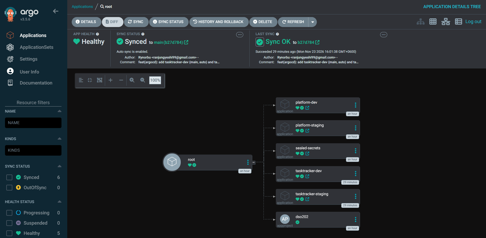

### Environments

| Property | dev | staging |
|---|---|---|
| Namespace | `dso202-dev` | `dso202-staging` |
| Application | `tasktracker-dev` | `tasktracker-staging` |
| Revision | branch `main` (moves) | tag `v1.0.0` -> `v1.1.0` -> `v1.2.0` (tags never move) |
| Sync | automated, prune, self-heal | manual |
| Values | `environments/dev/values.yaml` | `environments/staging/values.yaml` |
| Frontend | NodePort 30080, mapped by kind -> http://localhost:30080 | NodePort 30081, not mapped -> port-forward to http://localhost:8082 |
| Credentials | SealedSecret in `platform/dev/` | separate SealedSecret in `platform/staging/` |
| Role | fast feedback | release gate |

### AppProjects

| Project | Used by | Destinations | Kinds | Created by |
|---|---|---|---|---|
| `platform` | root, sealed-secrets, platform-dev, platform-staging | argocd, sealed-secrets, dso202-dev, dso202-staging | all (administrator) | hand (bootstrap) |
| `dso202` | tasktracker-dev, tasktracker-staging | dso202-dev, dso202-staging only | Deployment, StatefulSet, Service, ConfigMap, ServiceAccount, Job, plus the child kinds ReplicaSet, ControllerRevision, Pod; no cluster-scoped kinds | root (Git) |

---

## 3. Repository layout

```
dso202-gitops_A4/
├── README.md                     this report
├── .gitignore                    first commit: keeps keys and plaintext out
├── cluster/kind-cluster.yaml     kind cluster (from Practical 1)
├── bootstrap/                    applied by hand, once per cluster
│   ├── argocd/                   Argo CD install (Kustomize + 2 patches)
│   └── root/                     platform AppProject + root Application
├── argocd/                       watched by root (app of apps)
│   ├── projects/dso202.yaml      workload AppProject
│   └── applications/             sealed-secrets, platform-*, tasktracker-*
├── platform/{dev,staging}/       namespace, quota + limits, RBAC, SealedSecret
├── charts/tasktracker/           Helm chart (from A3, adjusted to the contract)
├── environments/{dev,staging}/   values that differ per environment
└── docs/
    ├── evidence.md               command output for every task
    └── screenshots/              70 screenshots, one folder per task (task1/ ... task10/)
```

### Screenshot index

Every screenshot is stored in the folder of the task it proves, and every file is referenced from this report or from [`docs/evidence.md`](docs/evidence.md). No screenshot shows a password or key.

| Folder | Files | What the screenshots show |
|---|---|---|
| [`task1/`](docs/screenshots/task1) | 2 | tool versions, cluster nodes and the 30080 port mapping |
| [`task2/`](docs/screenshots/task2) | 3 | Argo CD Pods, port-forward and the first sign-in to the UI |
| [`task3/`](docs/screenshots/task3) | 3 | AppProjects, the root Application and its first child |
| [`task4/`](docs/screenshots/task4) | 8 | Sealed Secrets chart choice, controller, key backup, platform apps, quota and decrypted Secrets |
| [`task5/`](docs/screenshots/task5) | 13 | `v1.0.0` tag, wave order, smoke test, CRUD in dev, staging before and after its manual sync |
| [`task6/`](docs/screenshots/task6) | 6 | Argo CD accounts, reviewer `can-i` checks and user info, the read-only tree view, log access after the RBAC commit |
| [`task7/`](docs/screenshots/task7) | 16 | pull requests, frontend 1.1, faulty backend (Degraded, CrashLoopBackOff), refused rollback, revert, fix forward, staging promotion to `v1.2.0` |
| [`task8/`](docs/screenshots/task8) | 8 | the four drills: drift in dev, drift in staging, prune and the project guardrail |
| [`task9/`](docs/screenshots/task9) | 9 | state before the rebuild, rebuild steps and both environments working again |
| [`task10/`](docs/screenshots/task10) | 2 | `tasktracker-dev` with two sources, and its resource tree |

---

## 4. Pinned versions

| Component | Version |
|---|---|
| Argo CD (server) | v3.5.6 (`install.yaml` from tag v3.5.6) |
| argocd CLI | v3.5.6+c2b1e30 |
| Sealed Secrets Helm chart | 2.20.0 (controller 0.40.0) |
| kubeseal | 0.40.0 |
| kind | v0.32.0, node image `kindest/node:v1.36.1` |
| kubectl | v1.36.1 client (Kustomize v5.8.1) |
| Helm | v3.22.1 |
| Images | `rynorbu11/dso202-frontend`, `-backend`, `-db`, tags `1.0` and `1.1` only; `busybox:1.37` for the smoke test |

Chart 2.20.0 was chosen on purpose because it installs controller 0.40.0, the same version as `kubeseal`. The newer charts (2.21.0, 2.22.0) ship controller 0.41.2 (evidence 4.1).

---

## 5. Chart contract (C1-C11)

The Assignment 3 chart was adjusted so Argo CD can deliver it safely.

| # | Requirement | File | Key / change |
|---|---|---|---|
| C1 | Image repository and tag are per-tier values; no tag in templates | `templates/*-deployment.yaml`, `db-statefulset.yaml` | `required ... .Values.<tier>.image.tag` (A3 fallback to `.Chart.AppVersion` removed) |
| C2 | Configuration from values; a new backend variable is a values change only | `values.yaml`, `backend-deployment.yaml` | `backend.extraEnv` map rendered as `env:` (used for `TASK_PAGE_SIZE` in Task 7) |
| C3 | Chart never renders a Secret; reads `existingSecret` | `values.yaml`, `_helpers.tpl` | A3 `secret.yaml` deleted; `existingSecret: tasktracker-credentials` |
| C4 | Readiness probes on all tiers; backend `GET /api/status` | all workload templates | `readinessProbe` |
| C5 | Sync waves db 0, backend 1, frontend 2 | workload templates | `argocd.argoproj.io/sync-wave` |
| C6 | `progressDeadlineSeconds: 120` on backend and frontend | `backend-deployment.yaml`, `frontend-deployment.yaml` | `spec.progressDeadlineSeconds` |
| C7 | Requests and limits on every container | `values.yaml`, `smoke-test-job.yaml` | `resources` |
| C8 | No Namespace, ResourceQuota, LimitRange, Role or RoleBinding | chart | A3 `quota.yaml` deleted; these live in `platform/<env>/` |
| C9 | Ingress disabled by default | chart | no Ingress template exists |
| C10 | Frontend NodePort; the port is a value | `frontend-service.yaml`, environment values | 30080 dev, 30081 staging |
| C11 | `helm lint` clean and `helm template` works for both environments | whole chart | evidence 1.3 |

Other changes from A3:
- **The database is now a StatefulSet** with `volumeClaimTemplates` (as in A2). The chart renders no PersistentVolumeClaim, so the `dso202` whitelist matches the chart exactly.
- **All Pods use one ServiceAccount**, which has no mounted token.
- **`fullnameOverride: tasktracker`** gives fixed Service names (`tasktracker-backend`, ...).
- **The Helm test Pod and `NOTES.txt` were removed.** Argo CD does not use them, and the PostSync smoke test replaces the test.
- **A second ConfigMap, `tasktracker-frontend-nginx`, was added.** It is mounted over the image's `nginx.conf` and proxies `/api/` to `tasktracker-backend:8080`. The browser only ever calls the frontend's own URL (`frontend.backendUrl`: `http://localhost:30080` in dev, `http://localhost:8082` in staging), so no hosts-file entry or extra port-forward is needed. Evidence 5.3 shows this working: the API responses carry both `Server: nginx/1.31.3` and `X-Powered-By: Express`.

---

## 6. Build the whole environment from an empty machine

Requirements:
- Docker Desktop with at least 6 GB of memory.
- kind, kubectl, Helm, argocd CLI v3.5.6, kubeseal 0.40.0 and Git.
- The sealing-key backup `~/dso202-keys/sealing-key.backup.yaml`.

```bash
# 1. Get the repository
git clone https://github.com/Rynorbu/dso202-gitops_A4.git
cd dso202-gitops_A4

# 2. Create the cluster
kind create cluster --name dso202-gitops --config cluster/kind-cluster.yaml

# 3. Restore the sealing key BEFORE the controller is installed
kubectl create namespace sealed-secrets
kubectl apply -f ~/dso202-keys/sealing-key.backup.yaml

# 4. Install Argo CD and wait (allow more time on a slow network: every image is pulled again)
kubectl apply -k bootstrap/argocd --server-side --force-conflicts
kubectl wait --for=condition=Available deployment --all -n argocd --timeout=600s
kubectl rollout status statefulset/argocd-application-controller -n argocd --timeout=300s

# 5. Hand over to Git
kubectl apply -f bootstrap/root
kubectl get applications -n argocd -w      # wait for waves -3 .. 0

# 6. Sign in (port-forward in a second terminal) and release staging
kubectl port-forward svc/argocd-server -n argocd 8080:443
argocd admin initial-password -n argocd
argocd login localhost:8080 --username admin --insecure
argocd app sync tasktracker-staging

# 7. Use the app
#    dev:     http://localhost:30080
#    staging: kubectl port-forward -n dso202-staging svc/tasktracker-frontend 8082:8080
#             then http://localhost:8082
```

This exact procedure was tested in Task 9 (evidence Task 9).

## 7. Cleanup

```bash
# stop the port-forwards (Ctrl+C in their terminals), then:
kind delete cluster --name dso202-gitops
# KEEP ~/dso202-keys/sealing-key.backup.yaml - without it the SealedSecrets
# in this repository can never be decrypted again.
```

---

## 8. Credential handling

- **Git holds the database credentials only as SealedSecrets** (`platform/<env>/tasktracker-credentials.sealed.yaml`), encrypted with the controller's public key. Only the controller in the cluster holds the private key.
- **The plaintext inputs never reach Git.** They were written in an editor to `secrets-plain/<env>.env` (gitignored) and piped through `kubectl create secret --dry-run=client | kubeseal`, so no plaintext Secret was ever written to a file.
- **Dev and staging use different passwords and are sealed separately.** Strict scope binds each ciphertext to its name *and* namespace. The decrypted Secrets confirm this without revealing any value: the passwords are 9 bytes in dev and 12 bytes in staging (evidence 4.3).
- **The sealing key is backed up to `~/dso202-keys/`** (permission `600`). That is outside this repository and outside the OneDrive-synced Desktop. The backup was refreshed before the rebuild and used to restore the key in Task 9.
- **`.gitignore` is only a safety net** (it is the first commit, `3f5035a`). The real proof is `git log -p --all -S'<value>'`, which prints nothing for either user name, either password or the Argo CD admin password (evidence 4.4).
- **No screenshot in `docs/screenshots/` shows a password.** The screenshot of the initial admin password was deliberately left out of the repository.

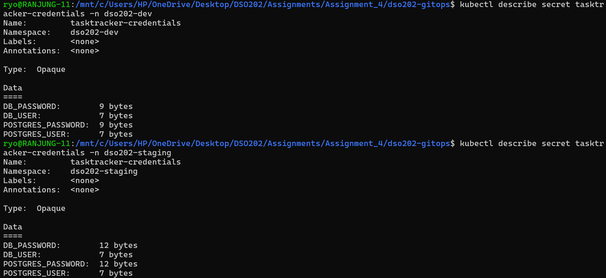

---

## 9. What was done, task by task

This section summarises each task with its most important screenshot. Every command and its output are in [`docs/evidence.md`](docs/evidence.md).

### Task 1 - Repository, chart and cluster
The repository starts with `.gitignore` as its first commit, followed by small, single-purpose commits: `main` now has 38 commits (29 work commits and 9 pull-request merges). The chart lints cleanly for both environments and renders only the kinds the workload layer is allowed to own. The kind cluster has one control plane and two workers, and NodePort 30080 is mapped to `localhost:30080`.

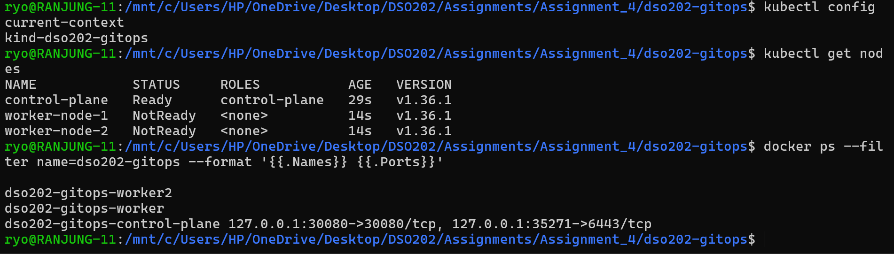

### Task 2 - Argo CD installed declaratively
Argo CD v3.5.6 was installed from a Kustomization that pins the upstream `install.yaml` by tag and merges two patches:
- **`argocd-cm`:** polling every 60 s, the local `reviewer` account, and a health check for Application objects.
- **`argocd-rbac-cm`:** the reviewer policy.

All 7 Pods came up with 0 restarts. Server-side apply was needed because the ApplicationSet CRD is too large for client-side apply.

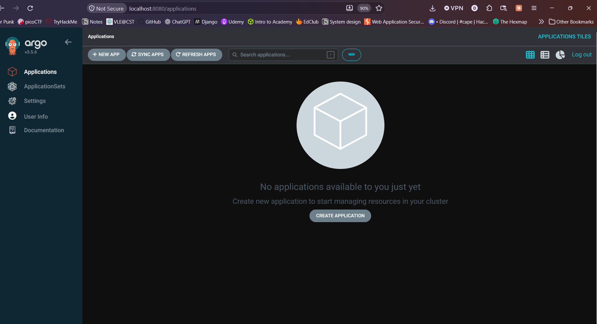

### Task 3 - Projects and the root Application
After `kubectl apply -f bootstrap/root`, root pulled `argocd/` from Git and created the `dso202` project (wave -3). From this point, nothing was created by hand.

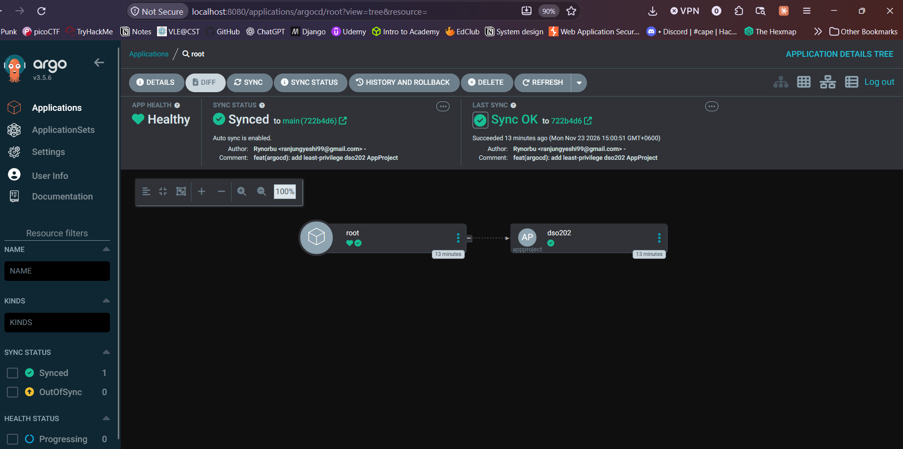

### Task 4 - Sealed Secrets and the platform layer
Root installed the Sealed Secrets controller (wave -2) and then the platform applications (wave -1):
- **The platform applications** created the namespaces, the ResourceQuota and LimitRange, the read-only RBAC and the SealedSecrets.
- **The controller** decrypted the SealedSecrets into `tasktracker-credentials`.

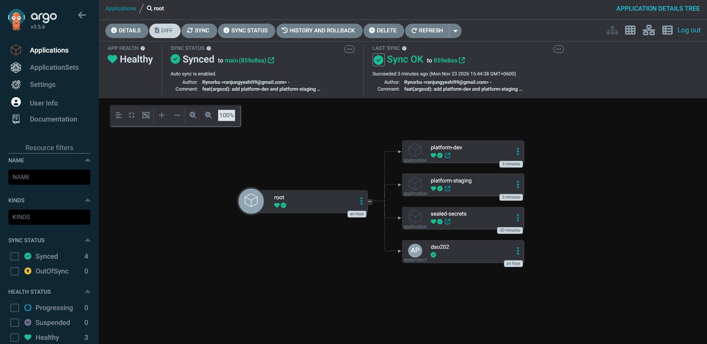

### Task 5 - Dev and staging
The Pods started strictly in wave order: database, then backend, then frontend, then the PostSync smoke test, which passed on its first attempt. The application then worked end to end: create, update and delete all succeeded through the nginx `/api/` proxy. Staging was created at the same time but stayed `OutOfSync` / `Missing` until the manual sync.

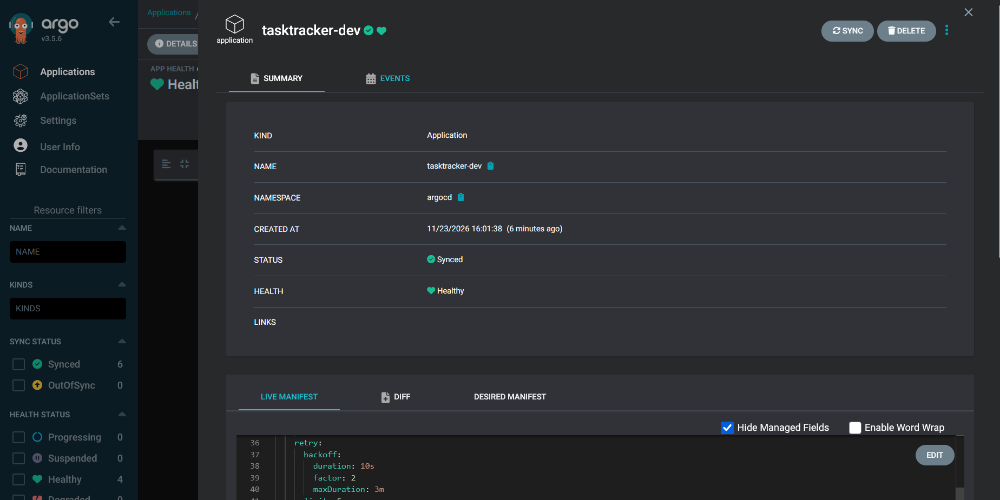

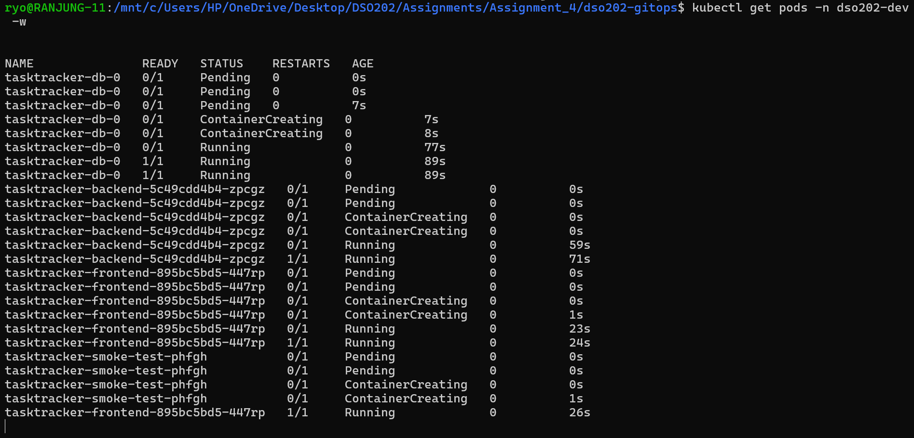

### Task 6 - Reviewer account
The `reviewer` account can view the two `dso202` applications. It cannot sync them, cannot see the `platform` project, and initially could not read logs. One committed line in the RBAC patch gave it log access. The reviewer could still not sync afterwards.

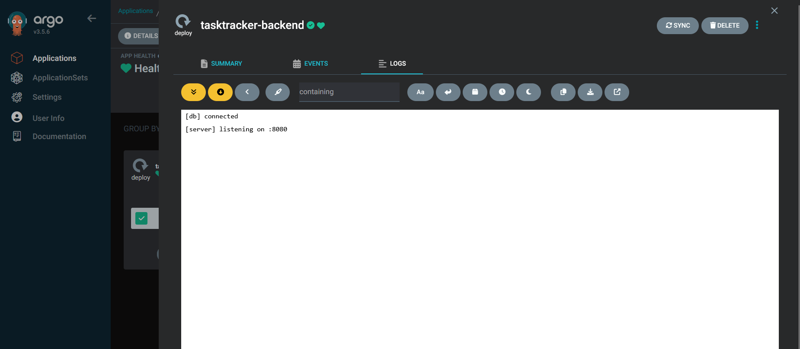

### Task 7 - A good release, a bad release and recovery
- **Frontend 1.1:** reached dev automatically and reached staging only after promotion and a manual sync.
- **Backend 1.1:** crashed because it needed a new setting. Dev became `Synced` but `Degraded`, while the old Pod kept serving and staging was untouched.
- **Rollback:** refused by Argo CD.
- **Recovery:** the bad commit was reverted through a PR, and the fixed release (backend 1.1 plus `TASK_PAGE_SIZE`) was shipped as `v1.2.0`.
- **Promotion:** staging was moved to `v1.2.0` by PR #9 and a manual sync. Its history now has two entries, `v1.1.0` and `v1.2.0`.

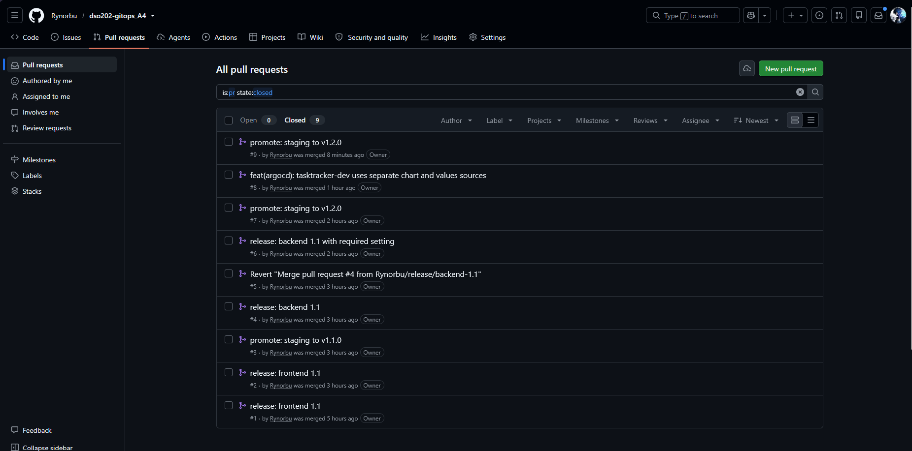

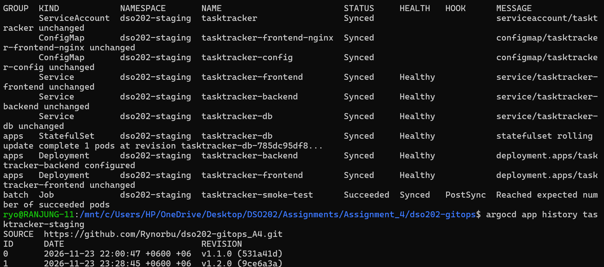

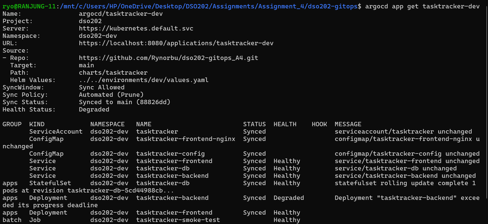

### Task 8 - Drift, prune and guardrails
Four drills, each with a prediction that turned out right:
- **Dev:** a manual scale was undone within a minute.
- **Staging:** a manual scale was only reported.
- **Prune:** a file deleted from Git deleted its object.
- **Guardrail:** a ResourceQuota in the workload chart was refused by the project.

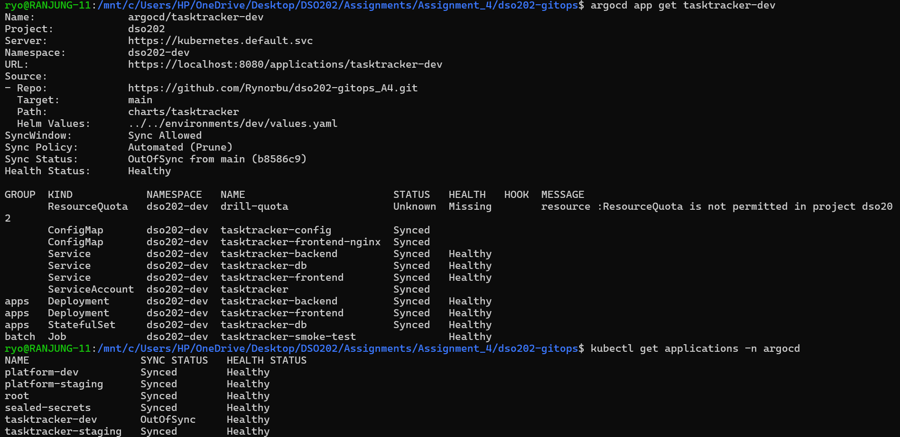

### Task 9 - Rebuild from Git
The cluster was deleted and rebuilt from this repository plus the key backup. Both environments came back with working smoke tests in about 28 minutes. Most of that time was spent downloading images.

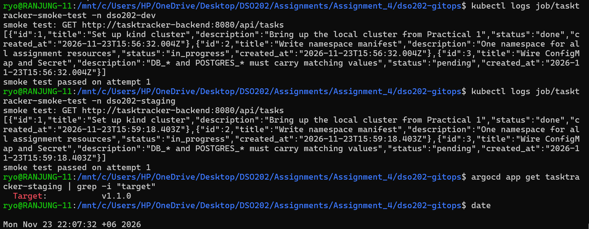

### Task 10 - Bonus
`tasktracker-dev` now reads the chart and the values as two separate sources: the chart from `charts/tasktracker`, and the values through a `ref: values` source used as `$values/environments/dev/values.yaml`. The change was merged as PR #8 (`f586466`), and Argo CD shows both sources with the application still Synced and Healthy.

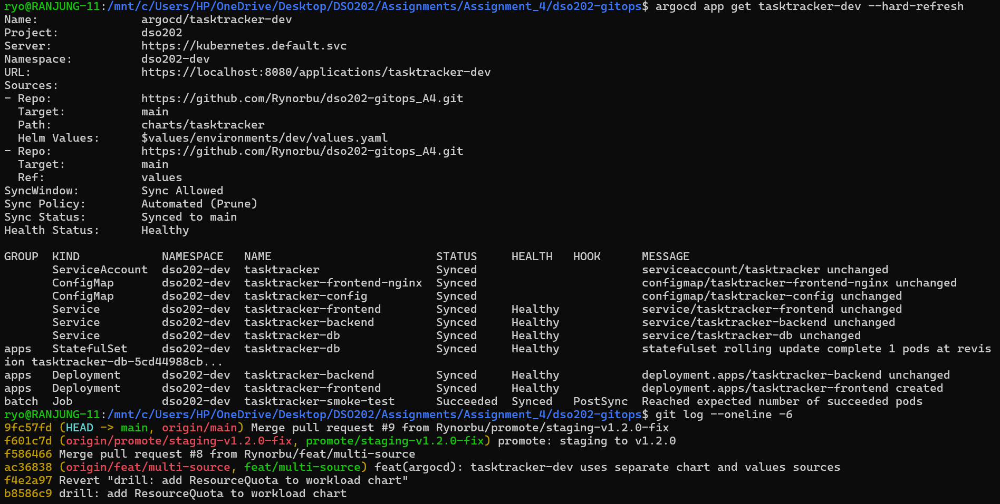

---

## 10. Releases

| Tag | Commit | Contents | How staging was promoted |
|---|---|---|---|
| `v1.0.0` | `b7e063a` | baseline: all images 1.0, chart and smoke test | initial `targetRevision` + manual sync |
| `v1.1.0` | `531a41d` | frontend 1.1 (header shows "RELEASE 1.1"), staging on port 8082 | PR #3 (`targetRevision: v1.1.0`) + manual sync |
| `v1.2.0` | `9ce6a3a` | backend 1.1 with the required setting `TASK_PAGE_SIZE: "50"` | PR #9 (`f601c7d`, merged as `9fc57fd`: `targetRevision: v1.2.0`) + manual sync. PR #7 had the same title but was missing the change (evidence 7.1) |

**Faulty release:** commit **`88826dd`** (PR #4, backend 1.1 without `TASK_PAGE_SIZE`) was reverted by commit **`294bdff`**, merged as PR #5 (**`5426eda`**). The fix forward was PR #6 (**`9ce6a3a`**, tagged `v1.2.0`). Staging never ran the faulty backend: it only ever followed the tags `v1.0.0`, `v1.1.0` and `v1.2.0`. The first two were cut before `88826dd`, and `v1.2.0` already contains its revert plus the fix, so the faulty configuration never reached staging.

| Release | dev | staging |
|---|---|---|
| frontend 1.1 | 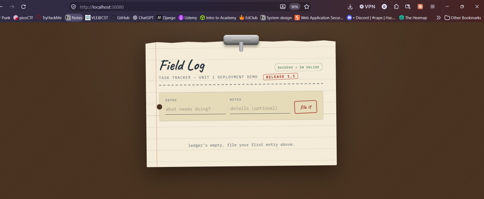 | 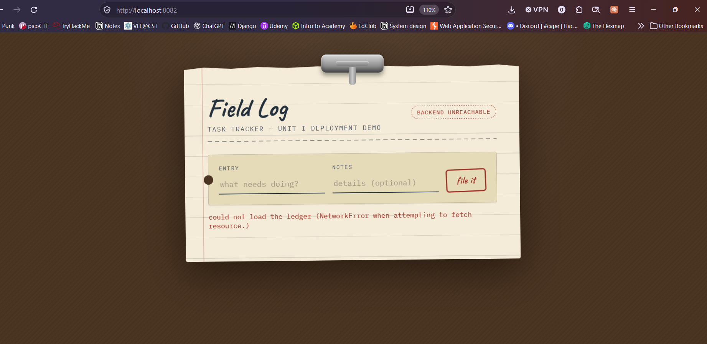 |

The staging page on the right still runs `v1.0.0` before its manual sync. Its "BACKEND UNREACHABLE" badge is explained in challenge 6.

---

## 11. Answers to the questions (Q1-Q6)

### Q1 - Why is `platform` applied by hand while `dso202` is created by root? What risk arises if `dso202` may deploy into `argocd`?

Root itself belongs to `platform`, and `platform` may create anything, including objects in the `argocd` namespace. If `platform` were delivered from Git by root, a commit could change the permissions of the project that delivers that very commit, so the project could widen its own rights. Applying it by hand, once, during the bootstrap puts it outside what Git can change: only an administrator with direct cluster access can alter it. `dso202`, on the other hand, is an ordinary low-privilege project. It is safe, and better, to create it from Git through root, because then it is declarative, versioned and reviewed like everything else.

If `dso202` could deploy into `argocd`, a commit to `charts/tasktracker` could render an `AppProject`, an `Application` or an Argo CD ConfigMap (for example `argocd-rbac-cm`) into the `argocd` namespace. The workload layer could then:
- create a new project with `*` permissions,
- give itself administrator rights,
- or create an Application that deploys anything anywhere.

That is privilege escalation through Git. In my setup, `argocd` appears only in the `platform` project. The `dso202` destinations are exactly `https://kubernetes.default.svc` with namespaces `dso202-dev` and `dso202-staging` (`argocd/projects/dso202.yaml`), and `clusterResourceWhitelist` is empty. Drill 4 shows that the project really enforces its limits: `resource :ResourceQuota is not permitted in project dso202`.

### Q2 - What does strict scope prevent, what is lost, and what must be done if the sealing key is lost?

**Prevents:** with strict scope, the Secret's name and namespace are part of the encryption. Someone who can create objects in another namespace, or under another name, cannot copy my SealedSecret there and have the controller decrypt it for them. A sealed file therefore cannot be used to steal credentials into another namespace.

**Lost:** flexibility. One sealed file cannot be reused for dev and staging. I had to seal twice (`platform/dev` and `platform/staging`), and renaming the Secret or moving it to another namespace requires sealing it again from the plaintext.

**If the key is lost:** no existing SealedSecret can be decrypted any more (`no key could decrypt secret`). The controller generates a new key, and every credential must be sealed again from the original plaintext and committed. If the old key may have *leaked*, rather than just been lost, the database passwords themselves must also be changed, because anyone with the old key can decrypt the old ciphertext from Git history. Task 9 shows the opposite case: because the key backup was restored *before* the controller started, the existing SealedSecrets decrypted without any change to Git.

### Q3 - Difference between Synced and Healthy, with an example

**Sync status** compares the live objects with Git: *Synced* means they match the rendered manifests. **Health status** says whether those objects actually work: Deployments available, Pods ready, Jobs succeeded. The two are independent.

Two examples from my cluster:
1. **Right after the Task 5 push (16:01:38),** root showed **Synced to main (b27d784)** but **Progressing**, and `tasktracker-dev` was **Synced** but **Progressing**. Every object existed as committed, but the database Pod was still starting (it was Ready only after 89 s).
2. **The faulty release in Task 7** was `Sync Status: Synced to main (88826dd)` with `Health Status: Degraded`, and the backend Deployment reported `Deployment "tasktracker-backend" exceeded its progress deadline`. Git and the cluster agreed completely, but the committed configuration did not work.

The opposite also happened: in Drill 2, staging was **OutOfSync** while still **Healthy**, because a manual change made it differ from Git without breaking it.

### Q4 - Argo CD RBAC vs Kubernetes RBAC; the SSO change to `policy.csv`

| | Argo CD RBAC | Kubernetes RBAC |
|---|---|---|
| Controls | what a user may do **through Argo CD** (view, sync or delete Applications, view logs, read projects) | what an identity may do **against the Kubernetes API** (get pods, create deployments, ...) |
| Subjects | Argo CD accounts (local `reviewer`) or SSO groups | users, groups, ServiceAccounts |
| Configured in | `argocd-rbac-cm` -> `policy.csv` (`bootstrap/argocd/argocd-rbac-cm-patch.yaml`) | Role/ClusterRole + RoleBinding objects (`platform/<env>/rbac.yaml`) |

Argo CD itself talks to Kubernetes with its own ServiceAccounts. A user who may "sync" in Argo CD therefore needs no Kubernetes rights at all, and a user without Argo CD rights cannot sync, even though Argo CD itself could. Task 6 shows the Argo CD side:
- `reviewer` answered `yes` for `get applications` and `no` for `sync`.
- `reviewer` got `PermissionDenied` for `projects, get, platform`.
- `reviewer` gained `logs, get` only after a committed policy line.

**With SSO (not configured here):** users would come from the identity provider. `policy.csv` would then grant rights to IdP **groups** through a role, instead of to the local account:
```
p, role:reviewer, applications, get, dso202/*, allow
p, role:reviewer, projects, get, dso202, allow
p, role:reviewer, logs, get, dso202/*, allow
g, dso202-reviewers, role:reviewer
```
The local `accounts.reviewer` entry in `argocd-cm` would be removed.

### Q5 - Why rollback is refused, the GitOps equivalent, and why `git revert`

`argocd app rollback tasktracker-dev` was refused with:

```
rpc error: code = FailedPrecondition desc = rollback cannot be initiated when auto-sync is enabled
```

A rollback sets the live state to an older revision, but `tasktracker-dev` has automated sync. On the next reconcile, Argo CD would see the difference from `main`, which still pointed at the bad commit `88826dd`, and sync forward to the bad version again. Argo CD therefore refuses rollback while automated sync is enabled.

The GitOps equivalent is to change the **desired state** in Git. `git revert -m 1 88826dd` created commit `294bdff`, which undoes the change. It was merged as PR #5 (`5426eda`), and Argo CD delivered it like any other commit: dev was Healthy again on backend 1.0.

`git revert` is preferred over deleting the commit (`git reset` plus a force-push) because:
- **History stays immutable.** The bad change and its undo are both recorded and auditable.
- **Nothing that already has the commit breaks.** Tags and other clones that contain it keep working.
- **No force-push is needed** on a protected branch.

### Q6 - (a) One repository for chart and configuration; (b) what is not under GitOps control

**(a) Advantages:**
1. **One place to look.** A reviewer sees the chart and its values together.
2. **A release is atomic.** One commit or tag contains the matching chart and values. For example, backend 1.1 and its new `TASK_PAGE_SIZE` setting arrived together in `v1.2.0`, so the image could never be deployed without its setting.

**Disadvantages:**
1. **Code changes and promotions share one history and one set of permissions.** Anyone who can change the chart can also change staging's configuration.
2. **Every commit is a new revision for everything that follows `main`.** Even documentation commits count. A staging tag also covers the whole repository: my `v1.0.0` tag froze an old staging port value together with the chart (challenge 6).

Argo CD's best practices therefore recommend a separate configuration repository. The bonus Task 10 already uses the multi-source technique that makes that split possible: `tasktracker-dev` reads the chart and the values as two sources (PR #8), so moving `environments/` to its own repository would only change the `repoURL` of the `values` source.

**(b) Not under GitOps control after the rebuild:**

| Item | How it was handled here | How production teams usually handle it |
|---|---|---|
| The cluster itself | `kind create cluster` by hand | Infrastructure as code (Terraform, Cluster API) or a managed cluster |
| Bootstrap layer (Argo CD install) | `kubectl apply -k` by hand | Installed by the same IaC, or a managed Argo CD, which then often manages itself |
| Root Application + platform project | `kubectl apply -f` by hand | Created by the IaC that creates the cluster, so no person is needed |
| Sealing key | file backup in `~/dso202-keys`, restored by hand | A cloud KMS, Vault or a secret manager with access control and audit, or External Secrets Operator |
| Database contents | lost: the tasks created before the rebuild were gone | Automated backups (Velero, `pg_dump` to object storage) or a managed database with point-in-time recovery |
| Staging release | manual `argocd app sync` | Intentionally manual (release gate), or automated with sync windows and approvals |

**Rebuild time in my test:** about **27 min 51 s**, from the start of `kind delete` / `kind create` (21:34:53) to the first task created in the rebuilt dev frontend (22:02:44). Most of this was spent downloading images again. The Redis image alone took over 7 minutes, and I loaded it by hand (evidence Task 9). With the images cached locally, the Argo CD part takes only a few minutes.

---

## 12. Challenges and how they were solved

| # | Problem | Cause | Solution |
|---|---|---|---|
| 1 | Kustomize patch "no matches for argocd-cm.argocd" | the upstream `install.yaml` ConfigMaps have no namespace | removed `namespace:` from both patches; the Kustomization adds it |
| 2 | The A3 chart rendered a Secret, ResourceQuota, LimitRange and PVC | A3 chart design | deleted those templates, moved the database to a StatefulSet, and gave quota and RBAC to the platform layer |
| 3 | The browser could not reach the API | `tasktracker-backend` does not resolve outside the cluster, and `localhost:8080` is taken by the Argo CD port-forward | added `frontend-nginx-configmap.yaml`: nginx proxies `/api/` to the backend Service, and `frontend.backendUrl` is the frontend's own URL |
| 4 | Smoke-test Job below the LimitRange minimum | A2 LimitRange minimum 50m / 64Mi | lowered the minimum to 10m / 16Mi in `platform/<env>/quota-and-limits.yaml` |
| 5 | Ports 8081 and 8082 were used by another project | a k3d cluster from other coursework publishes `8081->80` and `8082->443`, so `localhost:8082` returned Traefik's "404 page not found" | moved staging to 8082 as a values-only change (`backendUrl`, `corsOrigin`) and paused the other cluster while working on this assignment |
| 6 | Staging on `v1.0.0` showed "BACKEND UNREACHABLE" | `v1.0.0` was tagged before the port change, so that release still pointed the browser at `localhost:8081` | the tag cannot change (immutable), so the fix came with the next release: `v1.1.0` contains the 8082 values |
| 7 | `argocd` CLI: "Argo CD server address unspecified" | the CLI was not logged in | `argocd login localhost:8080 --username admin --insecure` |
| 8 | The port-forward stopped working ("lost connection to pod", "failed to find sandbox") | a port-forward is bound to one Pod; restarting `argocd-server` or syncing staging replaced that Pod | started the port-forward again after every restart or sync |
| 9 | `reviewer` still had `can-i get logs = no` after the RBAC change | the edit to the patch file had not been saved, so the commit still had the line commented out | uncommented the line, committed (`b786c16`) and applied it |
| 10 | Even with log permission, the UI showed "no pod groups" and `argocd app logs` was empty | Argo CD filters the resource tree through the project whitelist, and ReplicaSet and Pod were not whitelisted | added ReplicaSet, ControllerRevision and Pod to `dso202` (`a6a33e0`) |
| 11 | The 1.1 images did not exist on Docker Hub | needed for Task 7 | built them from my A1 source: frontend 1.1 adds a "RELEASE 1.1" stamp; backend 1.1 exits unless `TASK_PAGE_SIZE` is set; pushed both to Docker Hub |
| 12 | PR #1 and PR #7 did not contain the change their titles promised | the edits were not part of the committed diff (PR #1 had only the port change, PR #7 only `evidence.md`) | PR #2 made the real frontend tag change; PR #9 made the real staging promotion to `v1.2.0`. Lesson: check `git diff --stat` before opening a PR |
| 13 | `git revert 88826dd` needs a parent number | PR #4 was merged with a merge commit, not squashed | `git revert -m 1 88826dd` |
| 14 | Drill 4 first looked like it had no effect | Argo CD had not polled Git yet (60 s interval) | `argocd app get tasktracker-dev --hard-refresh` |
| 15 | Rebuild: `kubectl wait` timed out, `argocd-server` had `CreateContainerConfigError: secret "argocd-redis" not found`, and `root` stayed `Unknown` | every image had to be downloaded again; the Redis image was very slow, and the `argocd-redis` Secret is created by Redis's init container | pulled the Redis image with Docker; `kind load docker-image` failed with `content digest ... not found`, so I deleted the Redis Pod and it started on a node that already had the image |

---

## 13. Conclusion

After this assignment, a merged pull request is the deployment. Within about a minute of a merge to `main`, Argo CD applies it to dev, in wave order, and checks it with a smoke test. Staging changes only when a release tag is promoted and someone syncs it by hand.

That gate proved its value in Task 7. Backend 1.1 crashed in dev (Synced but Degraded), but the old Pod kept serving, staging stayed on `v1.1.0` until the fixed `v1.2.0` was promoted, and the problem was fixed with a `git revert` and a fix forward, never by editing the cluster.

The drills showed the other side of reconciliation:
- manual drift in dev is undone automatically;
- drift in staging is reported, not undone;
- deleted files are pruned;
- the workload project refuses kinds it does not own.

The full rebuild from Git plus one key took about 28 minutes on my laptop, and most of that was image downloads.

The bonus task showed that the chart and the values can already be consumed as separate sources, which is the first step towards a separate configuration repository.

The two PRs that were merged without their intended change showed that in GitOps the review of the diff *is* the release check. For production I would:
- protect `main` and require reviews and a passing CI check of `helm template` on every PR;
- keep the sealing key in a KMS or Vault;
- create the cluster and the bootstrap layer with infrastructure as code;
- back up the database automatically;
- move the environment configuration to its own repository with multiple sources.

---

## 14. References

- Argo CD v3.5 documentation - https://argo-cd.readthedocs.io/ (Declarative Setup, Projects, Sync Phases and Waves, Automated Sync, Sync Options, Resource Health, RBAC, User Management, Multiple Sources, Best Practices)
- Sealed Secrets - https://github.com/bitnami/sealed-secrets
- OpenGitOps principles - https://opengitops.dev/
- Kubernetes documentation - https://kubernetes.io/docs/
- Helm documentation - https://helm.sh/docs/
- Kustomize - https://kustomize.io/
- Vinto, N. and Bueno, A. (2023) *GitOps Cookbook*. O'Reilly.
