<!--
=============================================================================
File        : docs/evidence.md
Assignment  : DSO202 Assignment 4 - GitOps delivery with Argo CD
Descriptor  : 4.1-4.4 (evidence for every task)
Purpose     : Command output and screenshots proving each task, one section
              per task, each with an observation of what it proves.
              No password, admin password or key content appears here or in
              any screenshot.
=============================================================================
-->

# Evidence - DSO202 Assignment 4

| | |
|---|---|
| Repository | https://github.com/Rynorbu/dso202-gitops_A4 |
| Tags | `v1.0.0`, `v1.1.0`, `v1.2.0` |
| Commit before the rebuild (Task 9) | `f4e2a97ee6077949ee1da522a8529e2225b62b61` |
| Final commit of the work | `9fc57fd` (PR #9) |
| Commits on `main` | 38 (29 work commits and 9 pull-request merges), `.gitignore` first |
| Environment | Windows 11, WSL Ubuntu, Docker Desktop, kind cluster `dso202-gitops` |

All terminal output below was taken from the screenshots in `docs/screenshots/`, which has one folder per task (`task1/` to `task10/`). Long outputs are shortened with `...`.

## Contents

| Task | Topic | Screenshots |
|---|---|---|
| [Task 1](#task-1---repository-chart-contract-and-cluster) | Repository, chart contract and cluster | [`task1/`](screenshots/task1) |
| [Task 2](#task-2---install-argo-cd-declaratively) | Install Argo CD declaratively | [`task2/`](screenshots/task2) |
| [Task 3](#task-3---appprojects-and-the-root-application) | AppProjects and the root Application | [`task3/`](screenshots/task3) |
| [Task 4](#task-4---platform-layer-and-sealed-secrets) | Platform layer and Sealed Secrets | [`task4/`](screenshots/task4) |
| [Task 5](#task-5---deliver-workloads-to-dev-and-staging) | Deliver workloads to dev and staging | [`task5/`](screenshots/task5) |
| [Task 6](#task-6---access-control-for-argo-cd-users) | Access control for Argo CD users | [`task6/`](screenshots/task6) |
| [Task 7](#task-7---a-release-a-faulty-release-and-recovery) | A release, a faulty release and recovery | [`task7/`](screenshots/task7) |
| [Task 8](#task-8---drift-pruning-and-project-guardrails) | Drift, pruning and project guardrails | [`task8/`](screenshots/task8) |
| [Task 9](#task-9---rebuild-from-git) | Rebuild from Git | [`task9/`](screenshots/task9) |
| [Task 10](#task-10---bonus-chart-and-values-from-separate-sources) | Bonus: chart and values from separate sources | [`task10/`](screenshots/task10) |

---

## Task 1 - Repository, chart contract and cluster

### 1.1 Tool check

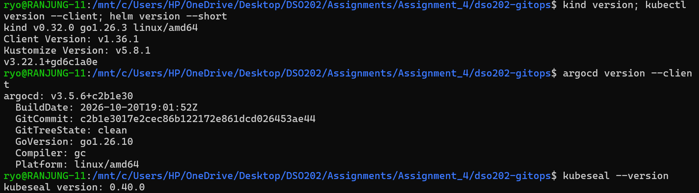

```text
$ kind version; kubectl version --client; helm version --short
kind v0.32.0 go1.26.3 linux/amd64
Client Version: v1.36.1
Kustomize Version: v5.8.1
v3.22.1+gd6c1a0e

$ argocd version --client
argocd: v3.5.6+c2b1e30
  BuildDate: 2026-10-20T19:01:52Z
  GitCommit: c2b1e3017e2cec86b122172e861dcd026453ae44
  Platform: linux/amd64

$ kubeseal --version
kubeseal version: 0.40.0
```
**Observation:** every tool runs inside WSL as a Linux binary. The argocd CLI (v3.5.6) matches the server version installed in Task 2, and kubeseal (0.40.0) matches the controller installed in Task 4.

### 1.2 Chart contract
See README section 5 (table C1-C11).

### 1.3 helm lint (dev and staging)
```text
$ helm lint charts/tasktracker -f environments/dev/values.yaml
==> Linting charts/tasktracker
[INFO] Chart.yaml: icon is recommended
1 chart(s) linted, 0 chart(s) failed

$ helm lint charts/tasktracker -f environments/staging/values.yaml
==> Linting charts/tasktracker
[INFO] Chart.yaml: icon is recommended
1 chart(s) linted, 0 chart(s) failed
```
**Observation:** the chart lints cleanly for both environments (C11). The only `[INFO]` line is a suggestion to add an icon.

### 1.4 Kinds rendered by the chart
```text
$ helm template tasktracker charts/tasktracker -f environments/dev/values.yaml | grep '^kind:' | sort | uniq -c
      2 kind: ConfigMap
      2 kind: Deployment
      3 kind: Service
      1 kind: ServiceAccount
      1 kind: StatefulSet
```
The two ConfigMaps are the application settings (`tasktracker-config`) and the frontend nginx proxy (`tasktracker-frontend-nginx`). The PostSync smoke-test Job is added in Task 5.
**Observation:** the chart renders no Secret, ResourceQuota, LimitRange, Role, RoleBinding or Namespace (C3, C8). These belong to the platform layer.

### 1.5 Cluster

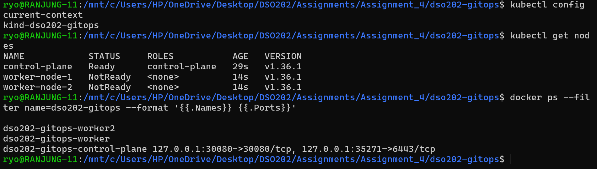

```text
$ kubectl config current-context
kind-dso202-gitops

$ kubectl get nodes
NAME            STATUS     ROLES           AGE   VERSION
control-plane   Ready      control-plane   29s   v1.36.1
worker-node-1   NotReady   <none>          14s   v1.36.1
worker-node-2   NotReady   <none>          14s   v1.36.1

$ docker ps --filter name=dso202-gitops --format '{{.Names}} {{.Ports}}'
dso202-gitops-worker2
dso202-gitops-worker
dso202-gitops-control-plane 127.0.0.1:30080->30080/tcp, 127.0.0.1:35271->6443/tcp
```
**Observation:** the cluster has one control plane and two workers on Kubernetes v1.36.1. The workers were still joining (14 s old) when this was captured, and became Ready shortly after. NodePort 30080 is mapped to `127.0.0.1:30080`, so the dev frontend is reachable from the Windows browser without a port-forward (C10).

---

## Task 2 - Install Argo CD declaratively

### 2.1 Render check (before applying)
```text
$ kubectl kustomize bootstrap/argocd | grep -E '^kind: (Deployment|StatefulSet)$' | sort | uniq -c
      6 kind: Deployment
      1 kind: StatefulSet

$ kubectl kustomize bootstrap/argocd | grep 'image:' | sort -u
        image: ghcr.io/dexidp/dex:v2.45.1
        image: public.ecr.aws/docker/library/redis:8.2.3-alpine
        image: quay.io/argoproj/argocd:v3.5.6
```
**Observation:** before anything was applied, the Kustomization renders 6 Deployments (server, repo-server, applicationset-controller, notifications-controller, dex-server, redis) and 1 StatefulSet (application-controller). Every Argo CD image is pinned to v3.5.6, and the upstream manifest is pinned by URL (`.../argo-cd/v3.5.6/manifests/install.yaml`), so the install is reproducible from Git.

### 2.2 Apply and wait
```text
$ kubectl apply -k bootstrap/argocd --server-side --force-conflicts
namespace/argocd serverside-applied
customresourcedefinition.apiextensions.k8s.io/applications.argoproj.io serverside-applied
customresourcedefinition.apiextensions.k8s.io/applicationsets.argoproj.io serverside-applied
customresourcedefinition.apiextensions.k8s.io/appprojects.argoproj.io serverside-applied
...
configmap/argocd-cm serverside-applied
configmap/argocd-rbac-cm serverside-applied
...
deployment.apps/argocd-server serverside-applied
statefulset.apps/argocd-application-controller serverside-applied
networkpolicy.networking.k8s.io/argocd-server-network-policy serverside-applied

$ kubectl wait --for=condition=Available deployment --all -n argocd --timeout=300s
deployment.apps/argocd-applicationset-controller condition met
deployment.apps/argocd-dex-server condition met
deployment.apps/argocd-notifications-controller condition met
deployment.apps/argocd-redis condition met
deployment.apps/argocd-repo-server condition met
deployment.apps/argocd-server condition met
```
**Observation:** server-side apply is required. The `applicationsets` CRD is larger than the 256 KB limit of the `last-applied-configuration` annotation that client-side apply writes. `argocd-cm` and `argocd-rbac-cm` were applied with my patches already merged by Kustomize, so the cluster was never edited by hand.

### 2.3 Pods and CRDs

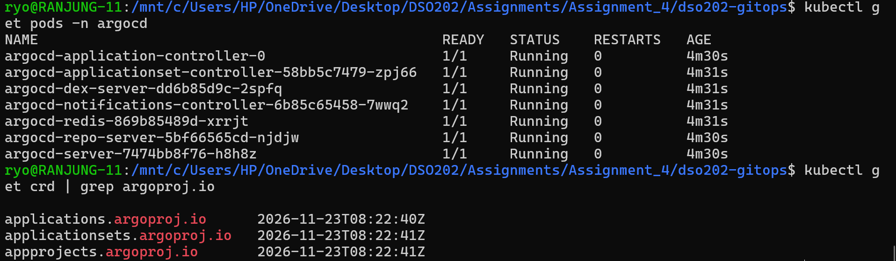

```text
$ kubectl get pods -n argocd
NAME                                                READY   STATUS    RESTARTS   AGE
argocd-application-controller-0                     1/1     Running   0          4m30s
argocd-applicationset-controller-58bb5c7479-zpj66   1/1     Running   0          4m31s
argocd-dex-server-dd6b85d9c-2spfq                   1/1     Running   0          4m31s
argocd-notifications-controller-6b85c65458-7wwq2    1/1     Running   0          4m31s
argocd-redis-869b85489d-xrrjt                       1/1     Running   0          4m31s
argocd-repo-server-5bf66565cd-njdjw                 1/1     Running   0          4m30s
argocd-server-7474bb8f76-h8h8z                      1/1     Running   0          4m30s

$ kubectl get crd | grep argoproj.io
applications.argoproj.io      2026-11-23T08:22:40Z
applicationsets.argoproj.io   2026-11-23T08:22:41Z
appprojects.argoproj.io       2026-11-23T08:22:41Z
```
**Observation:** all 7 Argo CD Pods are Running and Ready with 0 restarts, and the three Argo CD CRDs are installed.

### 2.4 Local settings applied and first sign-in
```text
$ argocd admin initial-password -n argocd
(output not recorded - the initial admin password is never written down)

$ kubectl get configmap argocd-cm -n argocd -o yaml | grep -E 'timeout.reconciliation|accounts.reviewer'
  accounts.reviewer: login
  timeout.reconciliation: 60s
  timeout.reconciliation.jitter: 10s

$ kubectl port-forward svc/argocd-server -n argocd 8080:443
Forwarding from 127.0.0.1:8080 -> 8080
Forwarding from [::1]:8080 -> 8080
Handling connection for 8080
```

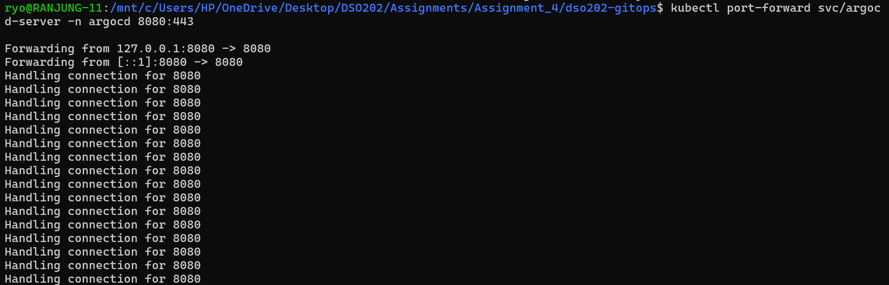

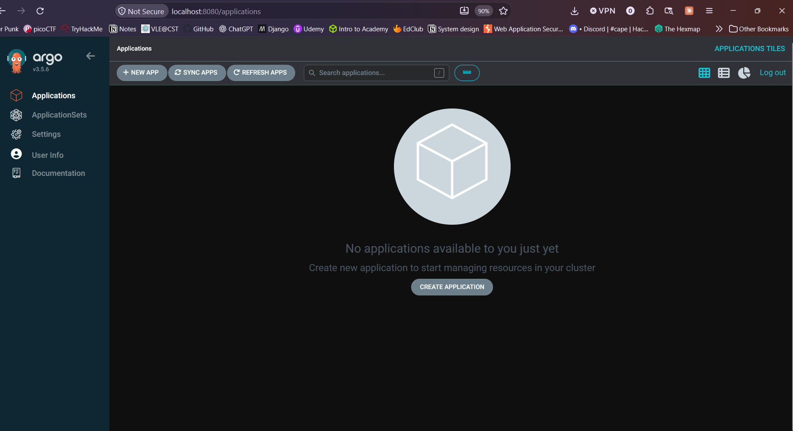

**Observation:** my `argocd-cm` patch is live. Argo CD polls Git every 60 s with up to 10 s of jitter, and the local account `reviewer` exists with the `login` capability only (used in Task 6). The UI sidebar shows server version **v3.5.6**, the same as the CLI. "No applications available" is correct at this point, because nothing has been handed to Argo CD yet.

---

## Task 3 - AppProjects and the root Application

### 3.1 Whitelist vs chart kinds
The kinds rendered by the chart (1.4) compared with `namespaceResourceWhitelist` in `argocd/projects/dso202.yaml`:

| Kind | Count | Objects | Group | In `dso202` whitelist |
|---|---|---|---|---|
| ConfigMap | 2 | `tasktracker-config`, `tasktracker-frontend-nginx` | `""` (core) | yes |
| Deployment | 2 | `tasktracker-backend`, `tasktracker-frontend` | `apps` | yes |
| Service | 3 | `tasktracker-db`, `tasktracker-backend`, `tasktracker-frontend` | `""` (core) | yes |
| ServiceAccount | 1 | `tasktracker` | `""` (core) | yes |
| StatefulSet | 1 | `tasktracker-db` | `apps` | yes |
| Job (PostSync smoke test, Task 5) | 1 | `tasktracker-smoke-test` | `batch` | yes |
| ReplicaSet (child object, added in Task 6) | - | created by each Deployment | `apps` | yes |
| ControllerRevision (child object, added in Task 6) | - | created by the StatefulSet | `apps` | yes |
| Pod (child object, added in Task 6) | - | created by ReplicaSets, StatefulSet and Job | `""` (core) | yes |

**Result:** the whitelist contains the 6 kinds the chart renders and nothing else that the chart could use to change its own budget, permissions or credentials (least privilege).
- **Child kinds (found in Task 6):** Argo CD filters an application's resource tree through the project whitelist. With only the 6 rendered kinds, the tree stopped at the Deployments: the UI said "Your application has no pod groups" and `argocd app logs` printed nothing, even after RBAC allowed logs. ReplicaSet, ControllerRevision and Pod were added (commit `a6a33e0`). Git never contains these objects, so this change only lets Argo CD *see* the Pods.
- **Not in the whitelist on purpose:** Secret (delivered as a SealedSecret by the platform layer), ResourceQuota, LimitRange, Role, RoleBinding (platform layer, `platform` project), PersistentVolumeClaim (the StatefulSet creates its own through `volumeClaimTemplates`) and Ingress (C9).
- **Cluster-scoped kinds:** `clusterResourceWhitelist: []`, so the workload project cannot create Namespaces, ClusterRoles or CRDs.
- Drill 4 (Task 8) proves the whitelist works: a ResourceQuota added to the chart was refused with "not permitted in project dso202".

### 3.2 Projects and root

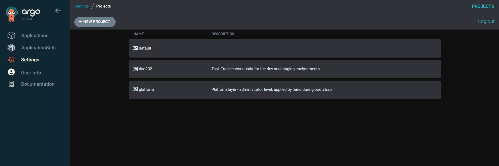

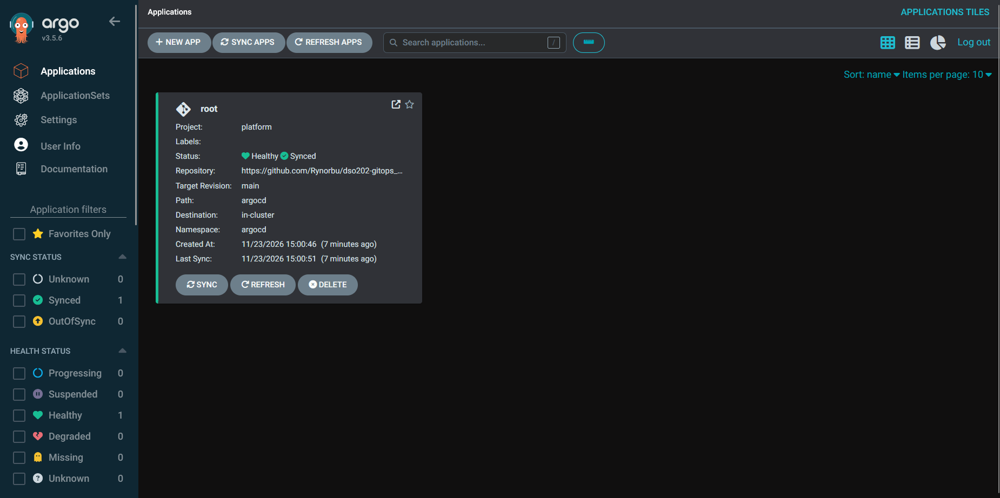

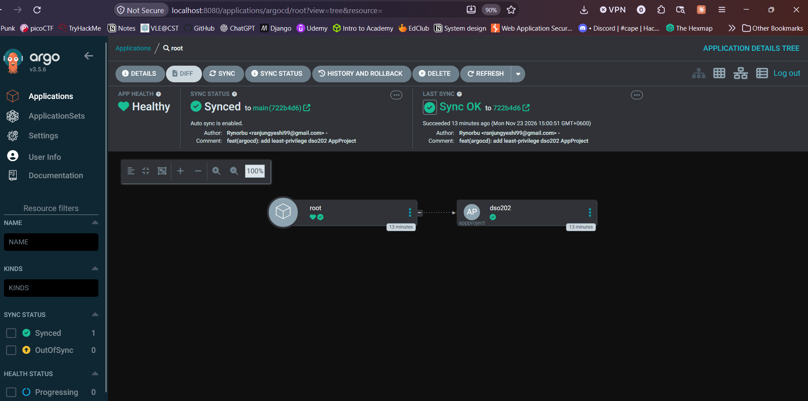

| Item | Value shown |
|---|---|
| Projects | `default`, `dso202` ("Task Tracker workloads for the dev and staging environments"), `platform` ("Platform layer - administrator level, applied by hand during bootstrap") |
| root | Project `platform`, repo `dso202-gitops_A4`, target `main`, path `argocd`, namespace `argocd` |
| root status | Healthy, Synced to `main (722b4d6)`, auto sync enabled, last sync 15:00:51 |
| root tree | root -> AppProject `dso202` |
| `dso202` destinations (from `argocd/projects/dso202.yaml`) | `https://kubernetes.default.svc` / `dso202-dev` and `dso202-staging` only |

**Observation:** after the one hand-applied step (`kubectl apply -f bootstrap/root`), root pulled `argocd/` from Git and created the `dso202` project itself (sync wave -3). Only `platform` and root were applied by hand. Everything after this point arrives through Git.

---

## Task 4 - Platform layer and Sealed Secrets

### 4.1 Controller installed through Git

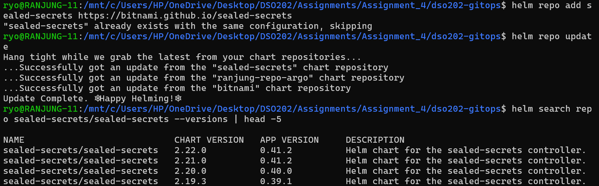

```text
$ helm search repo sealed-secrets/sealed-secrets --versions | head -5
NAME                            CHART VERSION   APP VERSION
sealed-secrets/sealed-secrets   2.22.0          0.41.2
sealed-secrets/sealed-secrets   2.21.0          0.41.2
sealed-secrets/sealed-secrets   2.20.0          0.40.0
sealed-secrets/sealed-secrets   2.19.3          0.39.1
```

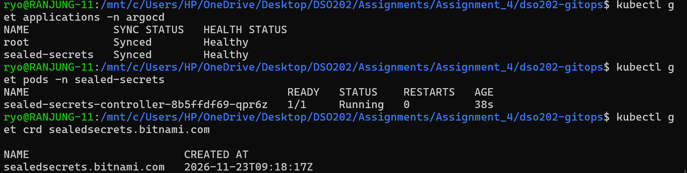

```text
$ kubectl get applications -n argocd
NAME             SYNC STATUS   HEALTH STATUS
root             Synced        Healthy
sealed-secrets   Synced        Healthy

$ kubectl get pods -n sealed-secrets
NAME                                        READY   STATUS    RESTARTS   AGE
sealed-secrets-controller-8b5ffdf69-qpr6z   1/1     Running   0          38s

$ kubectl get crd sealedsecrets.bitnami.com
NAME                        CREATED AT
sealedsecrets.bitnami.com   2026-11-23T09:18:17Z
```

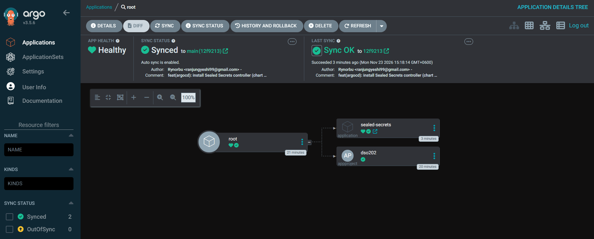

**Observation:** chart **2.20.0** was chosen on purpose because it installs controller **0.40.0**, the same version as my `kubeseal` CLI. The newer 2.21/2.22 charts ship controller 0.41.2. The controller was installed by root as a child Application (wave -2, commit `12f9213`), not with `helm install`.

### 4.2 Sealing key backup (outside the repo and outside OneDrive)

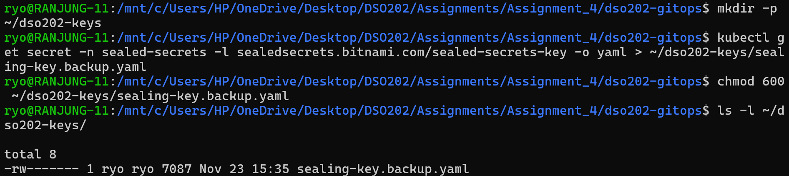

```text
$ mkdir -p ~/dso202-keys
$ kubectl get secret -n sealed-secrets -l sealedsecrets.bitnami.com/sealed-secrets-key -o yaml > ~/dso202-keys/sealing-key.backup.yaml
$ chmod 600 ~/dso202-keys/sealing-key.backup.yaml
$ ls -l ~/dso202-keys/
total 8
-rw------- 1 ryo ryo 7087 Nov 23 15:35 sealing-key.backup.yaml
```
**Observation:** the key is in the WSL home directory (`/home/ryo`). That is the Linux file system, so it is not in the repository and not in the OneDrive-synced Desktop. It is readable only by me (`600`). The contents were never displayed.

### 4.3 Platform delivered

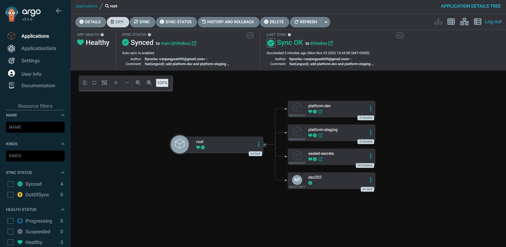

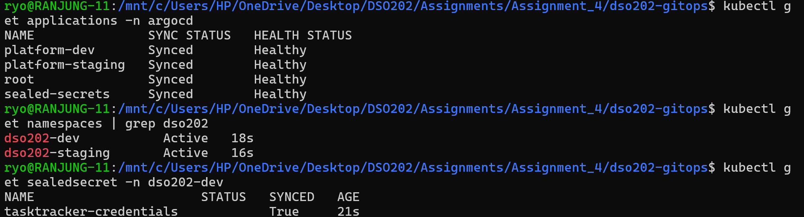

```text
$ kubectl get applications -n argocd
NAME               SYNC STATUS   HEALTH STATUS
platform-dev       Synced        Healthy
platform-staging   Synced        Healthy
root               Synced        Healthy
sealed-secrets     Synced        Healthy

$ kubectl get namespaces | grep dso202
dso202-dev       Active   18s
dso202-staging   Active   16s

$ kubectl get sealedsecret -n dso202-dev
NAME                      STATUS   SYNCED   AGE
tasktracker-credentials            True     21s
```

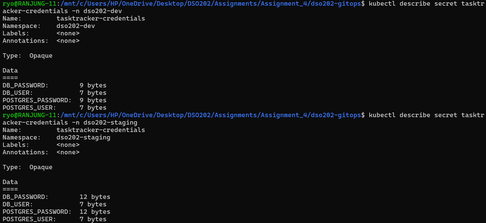

```text
$ kubectl describe secret tasktracker-credentials -n dso202-dev
Type:  Opaque
Data
====
DB_PASSWORD:        9 bytes
DB_USER:            7 bytes
POSTGRES_PASSWORD:  9 bytes
POSTGRES_USER:      7 bytes

$ kubectl describe secret tasktracker-credentials -n dso202-staging
Type:  Opaque
Data
====
DB_PASSWORD:        12 bytes
DB_USER:            7 bytes
POSTGRES_PASSWORD:  12 bytes
POSTGRES_USER:      7 bytes
```

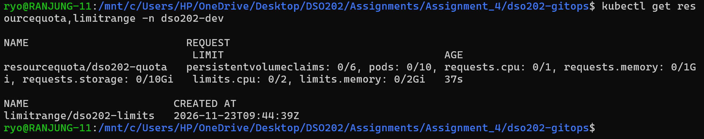

```text
$ kubectl get resourcequota,limitrange -n dso202-dev
NAME                          REQUEST                                                                                          LIMIT
resourcequota/dso202-quota    persistentvolumeclaims: 0/6, pods: 0/10, requests.cpu: 0/1, requests.memory: 0/1Gi,          limits.cpu: 0/2, limits.memory: 0/2Gi
                              requests.storage: 0/10Gi
NAME                          CREATED AT
limitrange/dso202-limits      2026-11-23T09:44:39Z
```
**Observation:** root created `platform-dev` and `platform-staging` (wave -1). They delivered the namespaces, quota, limits, RBAC and the SealedSecret, and the controller decrypted it (`SYNCED True`). The Secrets show only key names and sizes. The password sizes differ (9 bytes in dev, 12 in staging), which confirms the two environments have different passwords. `DB_*` and `POSTGRES_*` have equal sizes, as required, because the backend and the database must use the same credentials.

### 4.4 No plaintext in Git history

| Searched value (name only) | `git log -p --all -S'<value>'` output |
|---|---|
| dev and staging DB_USER (same user name) | empty |
| dev DB_PASSWORD | empty |
| staging DB_PASSWORD | empty |
| Argo CD initial admin password | empty |

```text
$ git status --short --ignored
!! secrets-plain/
```
**Observation:** no credential value appears anywhere in the history of any branch. The plaintext input folder `secrets-plain/` is ignored by `.gitignore` (the first commit, `3f5035a`) and was never committed. The sealed files are the only form of the credentials in Git.

---

## Task 5 - Deliver workloads to dev and staging

### 5.1 Tag v1.0.0

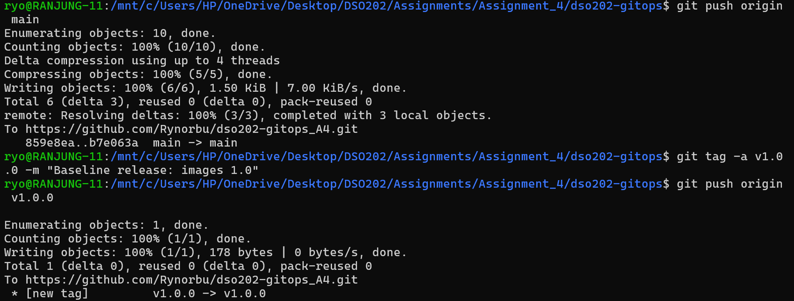

```text
$ git push origin main
To https://github.com/Rynorbu/dso202-gitops_A4.git
   859e8ea..b7e063a  main -> main
$ git tag -a v1.0.0 -m "Baseline release: images 1.0"
$ git push origin v1.0.0
To https://github.com/Rynorbu/dso202-gitops_A4.git
 * [new tag]         v1.0.0 -> v1.0.0
```
**Observation:** `v1.0.0` is an annotated tag on `b7e063a` (the commit that added the smoke-test Job). Staging is pinned to it.

### 5.2 Dev: wave order and smoke test

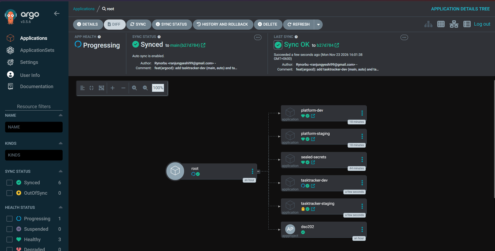

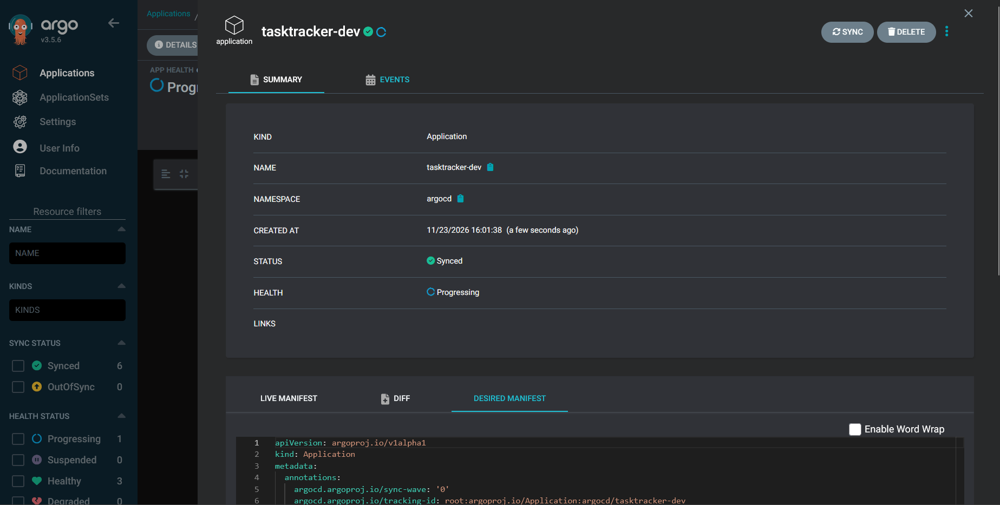

At 16:01:38 the root Application was **Synced to main (b27d784)** but **Progressing**, and `tasktracker-dev` was **Synced** but **Progressing**. This is the Synced-but-not-Healthy example used in Q3.

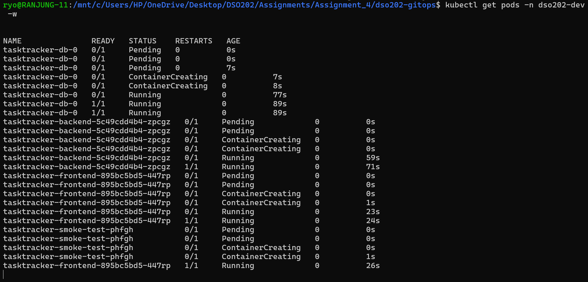

```text
$ kubectl get pods -n dso202-dev -w
NAME                                   READY   STATUS              AGE
tasktracker-db-0                       0/1     Pending             0s
tasktracker-db-0                       0/1     ContainerCreating   7s
tasktracker-db-0                       1/1     Running             89s      <- wave 0 ready
tasktracker-backend-5c49cdd4b4-zpcgz   0/1     Pending             0s       <- wave 1 starts only now
tasktracker-backend-5c49cdd4b4-zpcgz   1/1     Running             71s
tasktracker-frontend-895bc5bd5-447rp   0/1     Pending             0s       <- wave 2
tasktracker-frontend-895bc5bd5-447rp   1/1     Running             24s
tasktracker-smoke-test-phfgh           0/1     Pending             0s       <- PostSync hook
tasktracker-smoke-test-phfgh           0/1     ContainerCreating   1s
```

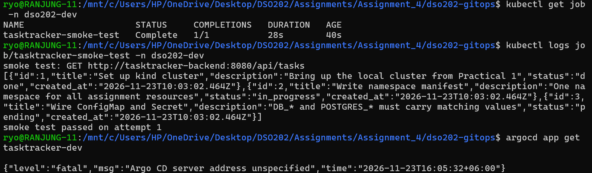

```text
$ kubectl get job -n dso202-dev
NAME                     STATUS     COMPLETIONS   DURATION   AGE
tasktracker-smoke-test   Complete   1/1           28s        40s

$ kubectl logs job/tasktracker-smoke-test -n dso202-dev
smoke test: GET http://tasktracker-backend:8080/api/tasks
[{"id":1,"title":"Set up kind cluster",...},{"id":2,"title":"Write namespace manifest",...},{"id":3,"title":"Wire ConfigMap and Secret",...}]
smoke test passed on attempt 1
```

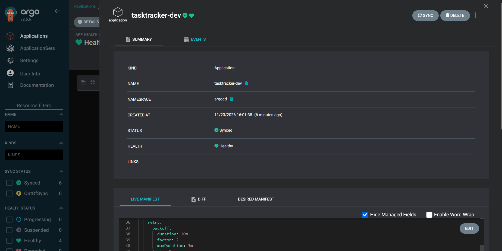

**Observation:** each tier was created only after the one before it was Ready: database (wave 0, Ready at 89 s), then backend (wave 1), then frontend (wave 2), then the PostSync smoke test. The smoke test called the backend through its Service, got the three seed tasks from PostgreSQL and passed on the first attempt. The application then turned Synced + Healthy.

### 5.3 CRUD in dev (http://localhost:30080)

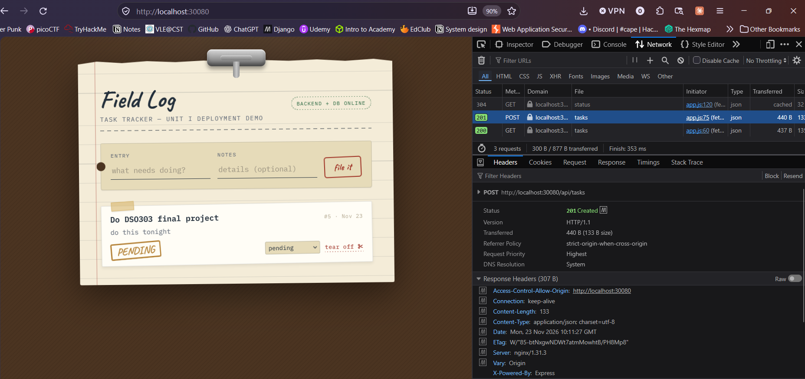

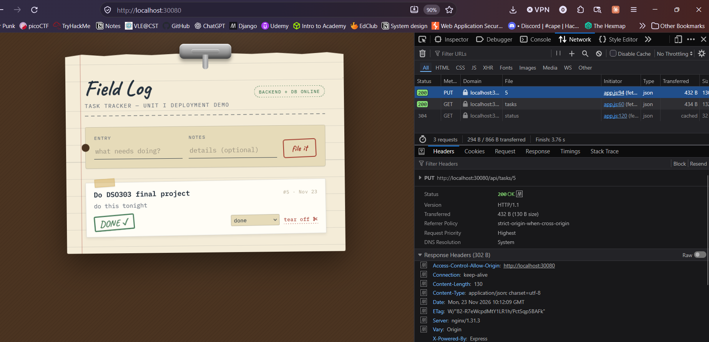

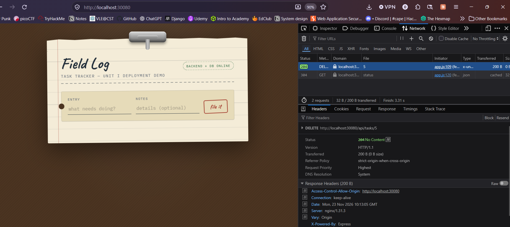

| Action | Request | Response |
|---|---|---|
| Create "Do DSO303 final project" | `POST http://localhost:30080/api/tasks` | `201 Created` |
| Update status to done | `PUT http://localhost:30080/api/tasks/5` | `200 OK` |
| Delete | `DELETE http://localhost:30080/api/tasks/5` | `204 No Content` |

**Observation:** the browser only talks to the frontend's own address. The response headers show `Server: nginx/1.31.3` together with `X-Powered-By: Express`: nginx in the frontend Pod proxied `/api/` to the Express backend Service. `Access-Control-Allow-Origin: http://localhost:30080` is the dev `corsOrigin` value. The badge "BACKEND + DB ONLINE" confirms the backend-to-PostgreSQL connection.

### 5.4 Staging (manual sync)

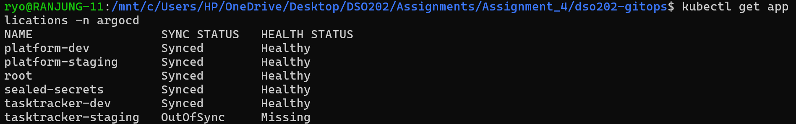

```text
$ kubectl get applications -n argocd
NAME                  SYNC STATUS   HEALTH STATUS
platform-dev          Synced        Healthy
platform-staging      Synced        Healthy
root                  Synced        Healthy
sealed-secrets        Synced        Healthy
tasktracker-dev       Synced        Healthy
tasktracker-staging   OutOfSync     Missing
```

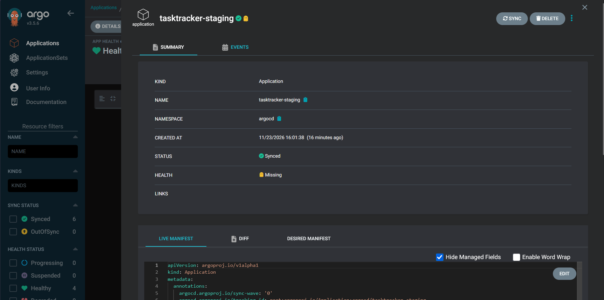

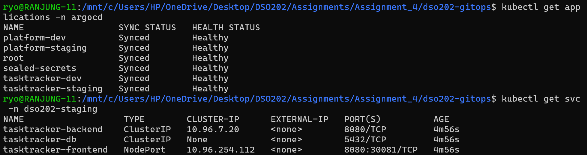

```text
$ kubectl get applications -n argocd
NAME                  SYNC STATUS   HEALTH STATUS
...
tasktracker-dev       Synced        Healthy
tasktracker-staging   Synced        Healthy

$ kubectl get svc -n dso202-staging
NAME                   TYPE        CLUSTER-IP      PORT(S)
tasktracker-backend    ClusterIP   10.96.7.20      8080/TCP
tasktracker-db         ClusterIP   None            5432/TCP
tasktracker-frontend   NodePort    10.96.254.112   8080:30081/TCP
```

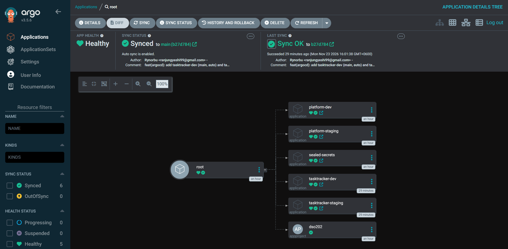

**Observation:** staging was created together with dev, but because it has no `automated` block, Argo CD only reported it (`OutOfSync` / `Missing`) and deployed nothing until I ran `argocd app sync tasktracker-staging`. That manual step is the release gate. In my cluster root stayed Synced/Healthy during this time, so the gate is visible on the staging Application itself, not on root. After the sync, staging runs on NodePort 30081, which kind does not map, so it is reached with `kubectl port-forward ... 8082:8080`.

---

## Task 6 - Access control for Argo CD users

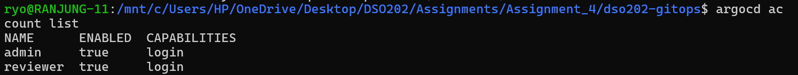

```text
$ argocd account list
NAME      ENABLED  CAPABILITIES
admin     true     login
reviewer  true     login
```

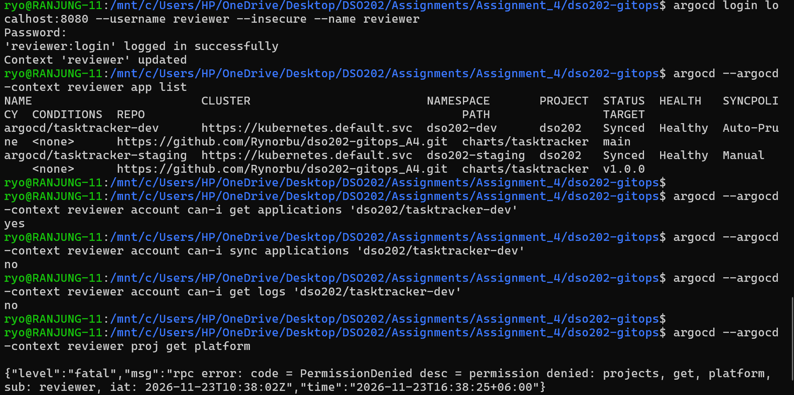

```text
$ argocd login localhost:8080 --username reviewer --insecure --name reviewer
'reviewer:login' logged in successfully

$ argocd --argocd-context reviewer app list
NAME                        PROJECT  STATUS  HEALTH   SYNCPOLICY  TARGET
argocd/tasktracker-dev      dso202   Synced  Healthy  Auto-Prune  main
argocd/tasktracker-staging  dso202   Synced  Healthy  Manual      v1.0.0

$ argocd --argocd-context reviewer account can-i get applications 'dso202/tasktracker-dev'
yes
$ argocd --argocd-context reviewer account can-i sync applications 'dso202/tasktracker-dev'
no
$ argocd --argocd-context reviewer account can-i get logs 'dso202/tasktracker-dev'
no
$ argocd --argocd-context reviewer proj get platform
{"level":"fatal","msg":"rpc error: code = PermissionDenied desc = permission denied: projects, get, platform, sub: reviewer, ..."}
```

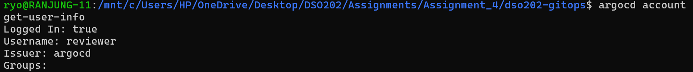

**Observation:** `reviewer` sees only the two `dso202` applications, not root, sealed-secrets or the platform apps. It can view but not sync, it cannot read logs yet, and it cannot even read the `platform` project. `policy.default: ""` means every right must be granted explicitly.

### Granting log access through a commit

The line `p, reviewer, logs, get, dso202/*, allow` was enabled in `bootstrap/argocd/argocd-rbac-cm-patch.yaml`, committed (`b786c16`) and applied with `kubectl apply -k bootstrap/argocd --server-side --force-conflicts`.

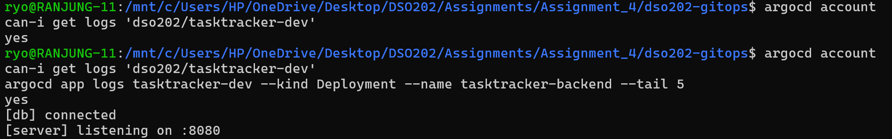

```text
$ argocd account can-i get logs 'dso202/tasktracker-dev'
yes
$ argocd app logs tasktracker-dev --kind Deployment --name tasktracker-backend --tail 5
[db] connected
[server] listening on :8080
```

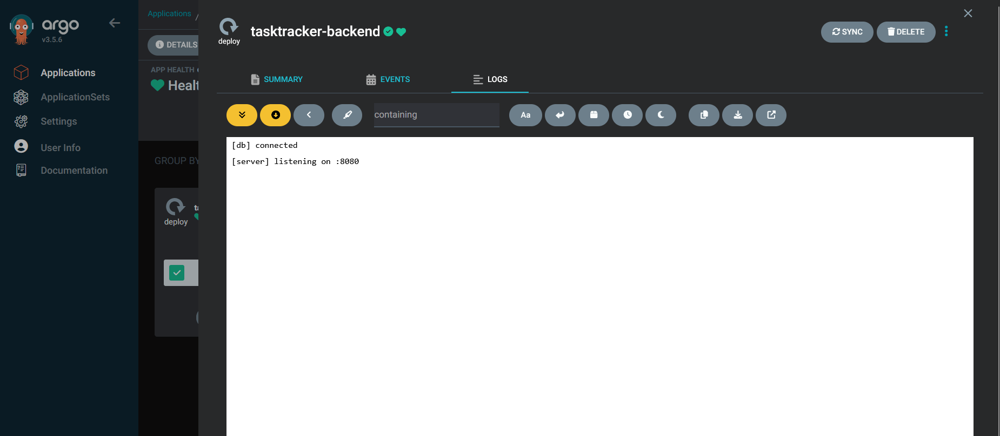

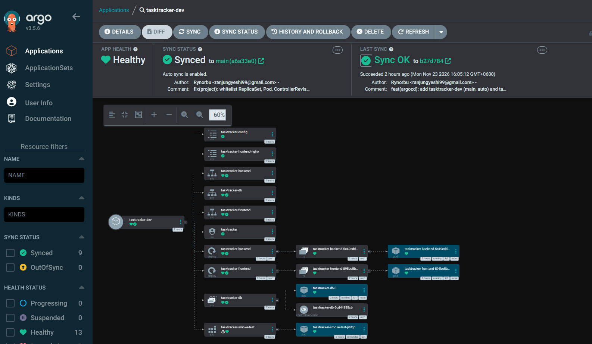

**Observation:** after the commit, the reviewer can read logs in both the CLI and the UI, but still cannot sync. On the first try the CLI still answered `no`, because my edit to the patch file had not been saved, so the committed file still had the line commented out. Even with `yes`, the logs were empty and the UI said "no pod groups". The cause was the project whitelist, not RBAC (see 3.1). After commit `a6a33e0` the tree shows ReplicaSets and Pods, and the logs appear.

---

## Task 7 - A release, a faulty release and recovery

### 7.1 Pull requests

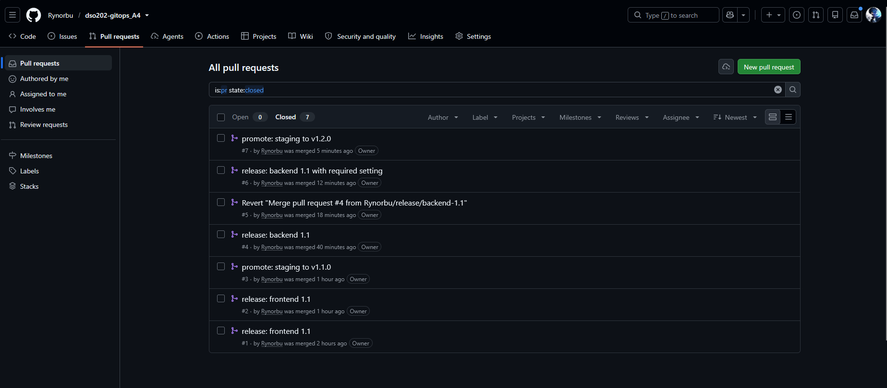

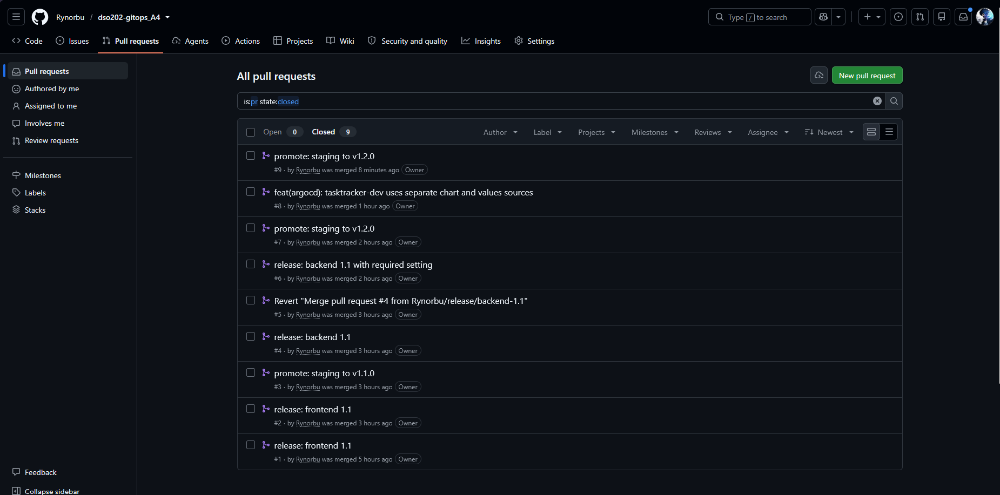

| PR | Title | Branch commit | Merge commit on `main` | What it changed |
|---|---|---|---|---|
| #1 | release: frontend 1.1 | `7753642` | `c42bc92` | Only the staging port change 8081 -> 8082. The image tag edit was missing (see note). |
| #2 | release: frontend 1.1 | `097fc9d` | `531a41d` (tag **v1.1.0**) | `frontend.image.tag` "1.0" -> "1.1" in dev and staging |
| #3 | promote: staging to v1.1.0 | `6f9da8d` | `d4a83a9` | staging `targetRevision` v1.0.0 -> v1.1.0 |
| #4 | release: backend 1.1 | `470acf4` | **`88826dd` (bad commit)** | `backend.image.tag` "1.0" -> "1.1" without the new setting |
| #5 | Revert "Merge pull request #4 ..." | `294bdff` | `5426eda` | revert of `88826dd` (backend back to 1.0) |
| #6 | release: backend 1.1 with required setting | `46be081` | `9ce6a3a` (tag **v1.2.0**) | backend 1.1 plus `extraEnv: TASK_PAGE_SIZE: "50"` |
| #7 | promote: staging to v1.2.0 | `07e2595` | `db4dc08` | Only `docs/evidence.md`. The `targetRevision` edit was missing (see note). |
| #8 | feat(argocd): tasktracker-dev uses separate chart and values sources | `ac36838` | `f586466` | Task 10: `tasktracker-dev` changed from one `source:` to two `sources:` |
| #9 | promote: staging to v1.2.0 | `f601c7d` | `9fc57fd` | staging `targetRevision` v1.1.0 -> v1.2.0 (the change PR #7 was missing) |

**Note on PR #1 and PR #7:** two PRs were merged without the change their title promised.
- **PR #1:** after the merge, dev still ran `rynorbu11/dso202-frontend:1.0`. `kubectl get deploy ... -o jsonpath` showed it, and the history of `tasktracker-dev` confirmed it. PR #2 made the real tag change.
- **PR #7:** found while writing this report. `git show --stat 07e2595` lists only `docs/evidence.md`, and the end of Task 9 shows staging still on `v1.1.0`. PR #9 made the real promotion (see 7.7).

In GitOps the merged diff *is* the deployment. A wrong diff deploys the wrong thing (or nothing), however good the PR title is. `git diff --stat` must be checked before every PR.

### 7.2 Frontend 1.1 in dev, staging gate

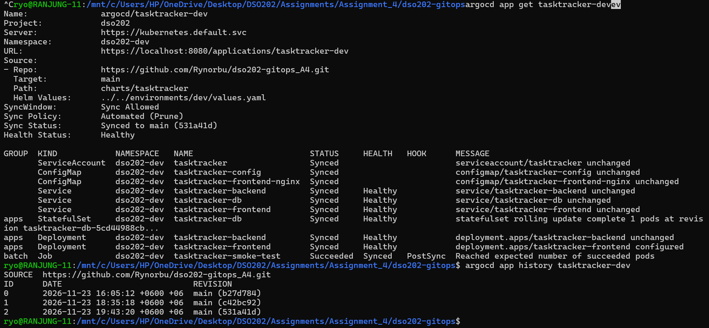

```text
$ argocd app get tasktracker-dev
Sync Policy:    Automated (Prune)
Sync Status:    Synced to main (531a41d)
Health Status:  Healthy
...
apps  Deployment  dso202-dev  tasktracker-frontend  Synced  Healthy  deployment.apps/tasktracker-frontend configured
batch Job         dso202-dev  tasktracker-smoke-test Succeeded Synced PostSync Reached expected number of succeeded pods

$ argocd app history tasktracker-dev
ID  DATE                        REVISION
0   2026-11-23 16:05:12 +0600   main (b27d784)
1   2026-11-23 18:35:18 +0600   main (c42bc92)
2   2026-11-23 19:43:20 +0600   main (531a41d)
```

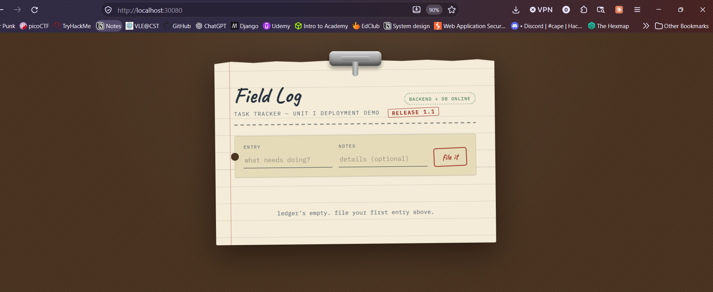

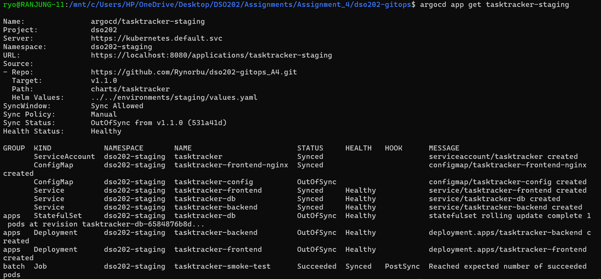

```text
$ argocd app get tasktracker-staging
Target:         v1.1.0
Sync Policy:    Manual
Sync Status:    OutOfSync from v1.1.0 (531a41d)
Health Status:  Healthy
...
apps  Deployment  dso202-staging  tasktracker-backend   OutOfSync  Healthy
apps  Deployment  dso202-staging  tasktracker-frontend  OutOfSync  Healthy
```

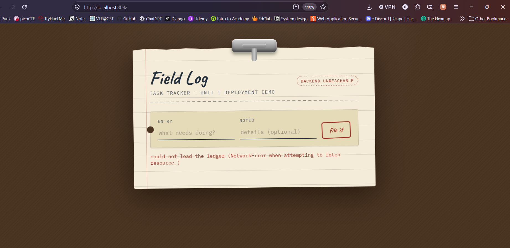

**Observation:**
- **Dev:** picked up the merge by itself within a minute and now shows the red "RELEASE 1.1" stamp.
- **Staging:** after PR #3 changed its target to `v1.1.0`, it only reported `OutOfSync` and kept running the old release (no stamp) until the manual sync.
- **The `v1.0.0` staging page shows "BACKEND UNREACHABLE".** The `v1.0.0` tag was cut before the staging port moved from 8081 to 8082, so the old release still told the browser to call `localhost:8081`, which is used by another project on my machine. The tag is immutable, so its configuration cannot be fixed in place. `v1.1.0` contains the 8082 values (from PR #1), and after the sync staging worked on `localhost:8082` (see Task 9).

### 7.3 Faulty backend - observation (no intervention)

Bad commit: **`88826dd`** (Merge pull request #4 from Rynorbu/release/backend-1.1)

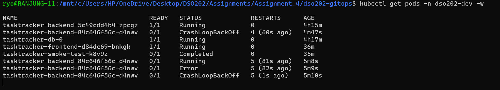

```text
$ kubectl get pods -n dso202-dev -w
NAME                                   READY   STATUS             RESTARTS       AGE
tasktracker-backend-5c49cdd4b4-zpcgz   1/1     Running            0              4h15m
tasktracker-backend-84c646f56c-d4wwv   0/1     CrashLoopBackOff   4 (60s ago)    4m47s
tasktracker-db-0                       1/1     Running            0              4h17m
tasktracker-frontend-d84dc69-bnkgk     1/1     Running            0              36m
tasktracker-backend-84c646f56c-d4wwv   0/1     Error              5 (82s ago)    5m9s
tasktracker-backend-84c646f56c-d4wwv   0/1     CrashLoopBackOff   5 (1s ago)     5m10s
```

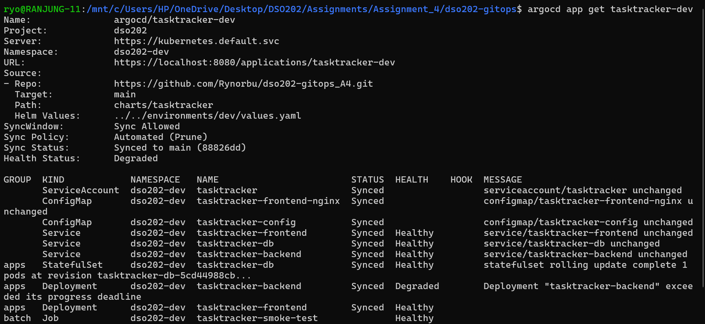

```text
$ argocd app get tasktracker-dev
Sync Status:    Synced to main (88826dd)
Health Status:  Degraded
...
apps  Deployment  dso202-dev  tasktracker-backend  Synced  Degraded  Deployment "tasktracker-backend" exceeded its progress deadline
```

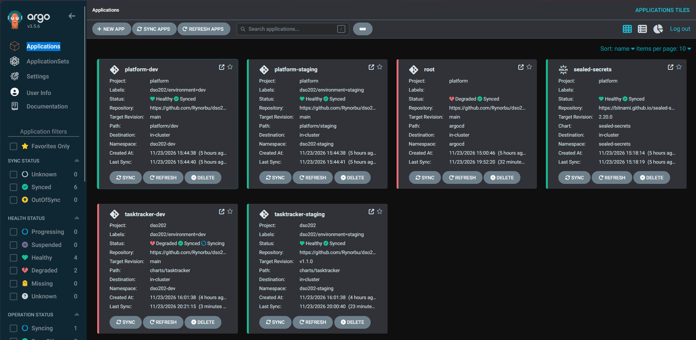

- **New backend Pod state:** `tasktracker-backend-84c646f56c-d4wwv` was `0/1` and alternated between `Error` and `CrashLoopBackOff` (5 restarts in 5 minutes).
- **Old backend Pod state:** `tasktracker-backend-5c49cdd4b4-zpcgz` stayed `1/1 Running`. The rolling update never removed it, because the new Pod never became Ready.
- **Sync / health:** **Synced** to `88826dd` but **Degraded**. After 120 s (`progressDeadlineSeconds`, C6) the Deployment reported "exceeded its progress deadline". The UI tile also showed the sync operation still "Syncing", and root turned Degraded.
- **Smoke test ran?** No. The PostSync hook runs only after all synced resources are Healthy, which never happened. The only smoke-test Pod is the Completed one from the earlier frontend release.
- **Frontend still responds?** Yes. The frontend Pod was not changed, and the old backend Pod stayed Ready behind the `tasktracker-backend` Service, so users kept the working 1.0 backend.
- **Staging:** unaffected. It stayed Healthy on `v1.1.0`, which does not contain the bad commit.

### 7.4 Diagnosis

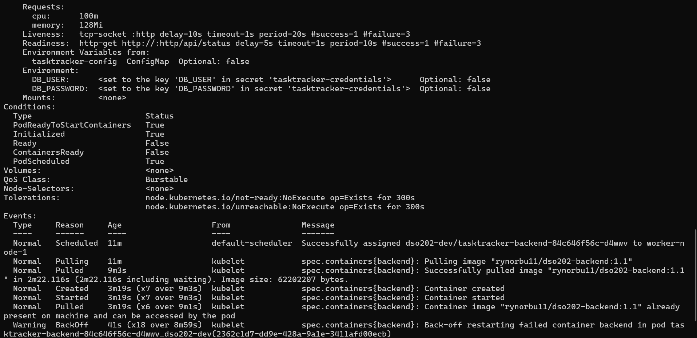

```text
$ kubectl describe pod tasktracker-backend-84c646f56c-d4wwv -n dso202-dev
...
    Readiness:  http-get http://:http/api/status delay=5s timeout=1s period=10s
Conditions:
  Ready             False
  ContainersReady   False
Events:
  Normal   Pulled   9m3s                 kubelet  Successfully pulled image "rynorbu11/dso202-backend:1.1" in 2m22.116s
  Normal   Created  3m19s (x7 over 9m3s) kubelet  Container created
  Normal   Started  3m19s (x7 over 9m3s) kubelet  Container started
  Warning  BackOff  41s (x18 over 8m59s) kubelet  Back-off restarting failed container backend in pod tasktracker-backend-84c646f56c-d4wwv_dso202-dev(...)
```

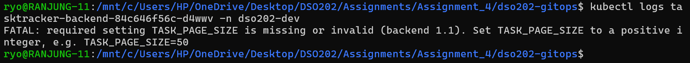

```text
$ kubectl logs tasktracker-backend-84c646f56c-d4wwv -n dso202-dev
FATAL: required setting TASK_PAGE_SIZE is missing or invalid (backend 1.1). Set TASK_PAGE_SIZE to a positive integer, e.g. TASK_PAGE_SIZE=50
```
Required by the image (exact log line): `FATAL: required setting TASK_PAGE_SIZE is missing or invalid (backend 1.1). Set TASK_PAGE_SIZE to a positive integer, e.g. TASK_PAGE_SIZE=50`

**Observation:** the image pulled correctly and the container started, then exited at once. The Events only say "Back-off restarting failed container". The real cause is in the container log: backend 1.1 needs a new setting, `TASK_PAGE_SIZE`, that the release did not provide.

### 7.5 Rollback refused

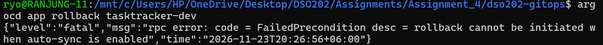

```text
$ argocd app rollback tasktracker-dev
{"level":"fatal","msg":"rpc error: code = FailedPrecondition desc = rollback cannot be initiated when auto-sync is enabled","time":"2026-11-23T20:26:56+06:00"}
```
**Why it is refused:** `tasktracker-dev` has automated sync, so Git (`main`) is the source of truth. A rollback in Argo CD would deploy an older revision while `main` still points at `88826dd`, and auto-sync would immediately put the bad version back. The fix has to go through Git.

### 7.6 Recovery by git revert, fix forward, promotion

**Revert (PR #5).** PR #4 had been merged with a merge commit, so the revert needs `-m 1` (keep the `main` side). The commands were `git checkout -b revert/backend-1.1` and `git revert -m 1 88826dd --no-edit`. They produced commit `294bdff Revert "Merge pull request #4 from Rynorbu/release/backend-1.1"`, which is visible in the Git graph below and was merged as PR #5 (`5426eda`).

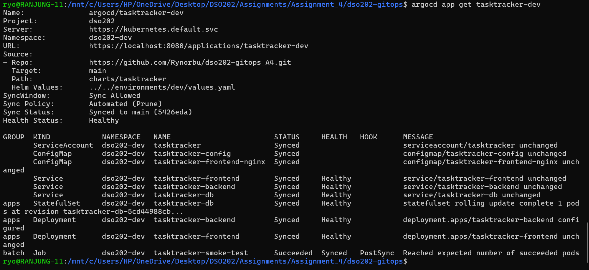

```text
$ argocd app get tasktracker-dev
Sync Status:    Synced to main (5426eda)
Health Status:  Healthy
apps  Deployment  dso202-dev  tasktracker-backend     Synced     Healthy  deployment.apps/tasktracker-backend configured
batch Job         dso202-dev  tasktracker-smoke-test  Succeeded  Synced   PostSync  Reached expected number of succeeded pods
```

**Fix forward (PR #6):** backend tag "1.1" again, plus the setting from the log, as a values-only change (C2):
```yaml
backend:
  image:
    tag: "1.1"
  extraEnv:
    TASK_PAGE_SIZE: "50"      # required by backend 1.1 (named in its crash log)
```

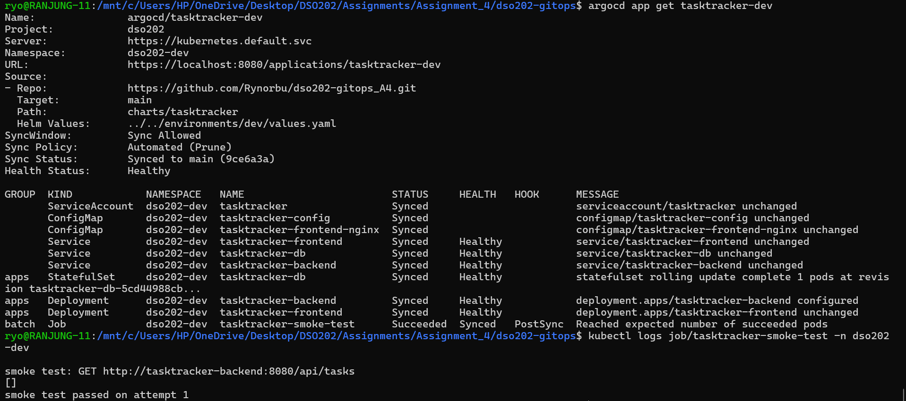

```text
$ argocd app get tasktracker-dev
Sync Status:    Synced to main (9ce6a3a)
Health Status:  Healthy
apps  Deployment  dso202-dev  tasktracker-backend  Synced  Healthy  deployment.apps/tasktracker-backend configured

$ kubectl logs job/tasktracker-smoke-test -n dso202-dev
smoke test: GET http://tasktracker-backend:8080/api/tasks
[]
smoke test passed on attempt 1
```
`9ce6a3a` was tagged **v1.2.0**.

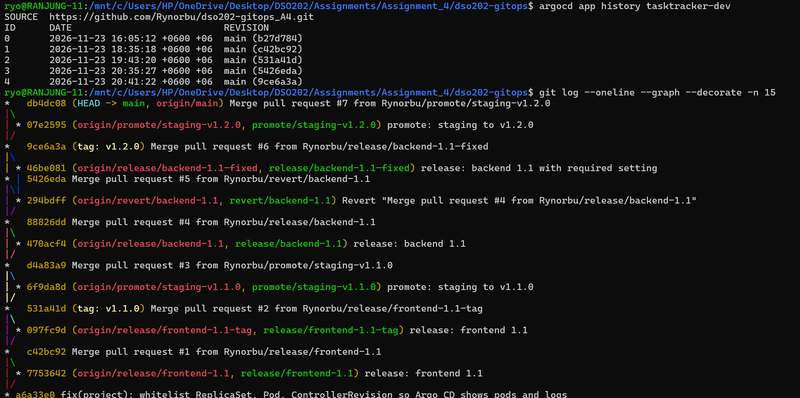

```text
$ argocd app history tasktracker-dev
ID  DATE                        REVISION
0   2026-11-23 16:05:12 +0600   main (b27d784)    baseline
1   2026-11-23 18:35:18 +0600   main (c42bc92)    PR #1
2   2026-11-23 19:43:20 +0600   main (531a41d)    PR #2, frontend 1.1 (v1.1.0)
3   2026-11-23 20:35:27 +0600   main (5426eda)    PR #5, revert
4   2026-11-23 20:41:22 +0600   main (9ce6a3a)    PR #6, fix forward (v1.2.0)

$ git log --oneline --graph --decorate -n 15
*   db4dc08 (HEAD -> main, origin/main) Merge pull request #7 from Rynorbu/promote/staging-v1.2.0
*   9ce6a3a (tag: v1.2.0) Merge pull request #6 from Rynorbu/release/backend-1.1-fixed
| * 46be081 release: backend 1.1 with required setting
*   5426eda Merge pull request #5 from Rynorbu/revert/backend-1.1
| * 294bdff Revert "Merge pull request #4 from Rynorbu/release/backend-1.1"
*   88826dd Merge pull request #4 from Rynorbu/release/backend-1.1
| * 470acf4 release: backend 1.1
*   d4a83a9 Merge pull request #3 from Rynorbu/promote/staging-v1.1.0
*   531a41d (tag: v1.1.0) Merge pull request #2 from Rynorbu/release/frontend-1.1-tag
*   c42bc92 Merge pull request #1 from Rynorbu/release/frontend-1.1
```
**Observation:**
- **The bad commit has no history entry.** Its sync operation never finished, because the PostSync hook waited for health that never came. The next entry is the revert.
- **History stayed intact.** The bad commit `88826dd` and its undo `294bdff` / `5426eda` are both on `main`, and nothing was force-pushed.
- **Staging never ran the bad backend.** It moved only between tags (`v1.0.0` -> `v1.1.0`), and neither tag contains `88826dd`.
- **Staging did not reach `v1.2.0` at this point.** PR #7 did not change `targetRevision` (see 7.1), so staging stayed on `v1.1.0` until PR #9 (see 7.7).

### 7.7 Promoting staging to v1.2.0

PR #9 changed `argocd/applications/tasktracker-staging.yaml` from `targetRevision: v1.1.0` to `targetRevision: v1.2.0` (branch commit `f601c7d`, merge commit `9fc57fd`). Staging then became `OutOfSync` and was synced by hand.


```text
$ argocd app sync tasktracker-staging
apps   StatefulSet  dso202-staging  tasktracker-db          Synced     Healthy             statefulset rolling update complete
apps   Deployment   dso202-staging  tasktracker-backend     Synced     Healthy             deployment.apps/tasktracker-backend configured
apps   Deployment   dso202-staging  tasktracker-frontend    Synced     Healthy             deployment.apps/tasktracker-frontend unchanged
batch  Job          dso202-staging  tasktracker-smoke-test  Succeeded  Synced   PostSync   Reached expected number of succeeded pods

$ argocd app history tasktracker-staging
SOURCE  https://github.com/Rynorbu/dso202-gitops_A4.git
ID  DATE                        REVISION
0   2026-11-23 22:00:47 +0600   v1.1.0 (531a41d)
1   2026-11-23 23:28:45 +0600   v1.2.0 (9ce6a3a)
```
**Observation:**
- **Only the backend changed.** `tasktracker-backend` is `configured` (image 1.0 -> 1.1 plus `TASK_PAGE_SIZE`), and every other object is `unchanged`, because `v1.1.0` already had frontend 1.1.
- **The backend 1.1 that crashed in dev runs cleanly in staging,** because `v1.2.0` ships the image together with its required setting. The PostSync smoke test passed.
- **Staging history has one entry per promoted tag.** Entry 0 is the manual sync after the Task 9 rebuild, and entry 1 is this promotion. Because staging has no automated sync, `argocd app rollback tasktracker-staging 0` would be allowed here, unlike in dev.

---

## Task 8 - Drift, pruning and project guardrails

### Drill 1 - drift in dev

- **Prediction:** the extra replicas will be removed within seconds, because `tasktracker-dev` has `selfHeal: true` and Git says 1 replica.


```text
$ kubectl scale deployment/tasktracker-backend -n dso202-dev --replicas=3
deployment.apps/tasktracker-backend scaled

$ kubectl get deployment/tasktracker-backend -n dso202-dev -w
NAME                  READY   UP-TO-DATE   AVAILABLE   AGE
tasktracker-backend   1/1     1            1           5h15m
tasktracker-backend   1/3     1            1           5h15m
tasktracker-backend   1/3     3            1           5h15m
tasktracker-backend   1/1     3            1           5h15m
tasktracker-backend   1/1     1            1           5h15m
tasktracker-backend   1/1     1            1           5h16m
```
- **Result and explanation:** the prediction was right. The Deployment went to 3 and was back at 1 within the same minute. Argo CD detected the difference from Git and self-heal re-applied the desired state, without any commit or person involved.

### Drill 2 - drift in staging

- **Prediction:** staging will be reported OutOfSync but will stay at 3 replicas, because it has no `automated` block and therefore no self-heal.


```text
$ kubectl scale deployment/tasktracker-backend -n dso202-staging --replicas=3
$ argocd app get tasktracker-staging
Sync Policy:    Manual
Sync Status:    OutOfSync from v1.1.0 (531a41d)
Health Status:  Progressing
apps  Deployment  dso202-staging  tasktracker-backend  OutOfSync  Progressing

$ argocd app diff tasktracker-staging
===== apps/Deployment dso202-staging/tasktracker-backend ======
188c188
<   replicas: 3
---
>   replicas: 1
```


```text
$ argocd app sync tasktracker-staging
Sync Status:    Synced to v1.1.0 (531a41d)
Health Status:  Healthy
Phase:          Succeeded
Start:          2026-11-23 21:22:33 +0600
Finished:       2026-11-23 21:22:46 +0600
Duration:       13s
apps  Deployment  dso202-staging  tasktracker-backend  Synced  Healthy  deployment.apps/tasktracker-backend configured
```
- **Result and explanation:** the prediction was right. Argo CD reported the drift (`OutOfSync`, with the exact diff `replicas: 3` live vs `1` in Git) but did not touch it. Only my manual sync restored 1 replica. Staging is reconciled in the sense of "observed and reported", while dev is "observed and corrected".

### Drill 3 - prune

- **Prediction:** when the file is deleted from Git, the ConfigMap will be deleted from the cluster, because `platform-dev` has `prune: true`.

```text
commit a223951  drill: add prune-drill ConfigMap      (platform/dev/prune-drill.yaml added, ConfigMap created by platform-dev)
commit 3074736  drill: remove prune-drill ConfigMap   (file deleted with git rm)
```


```text
$ kubectl get configmap prune-drill -n dso202-dev
Error from server (NotFound): configmaps "prune-drill" not found
```
- **Result and explanation:** the prediction was right. Removing the file from Git removed the object from the cluster, without `kubectl delete`. With `prune: false`, Argo CD would only have marked it as an orphan to delete by hand.
- **Why deleting `platform/dev/namespace.yaml` would NOT delete the namespace:** the Namespace carries the annotation `argocd.argoproj.io/sync-options: Prune=false`. Argo CD then never prunes that one object, even though the Application has `prune: true`. It reports the namespace as OutOfSync instead. This protects the namespace and everything in it (the database volume and the decrypted Secret) from being deleted by one bad commit. Pruning a namespace deletes all of its contents.

### Drill 4 - project guardrail

- **Prediction:** Argo CD will refuse to sync `tasktracker-dev`, because ResourceQuota is not in the `dso202` whitelist. The running application will stay Healthy.


```text
$ argocd app get tasktracker-dev        (after argocd app get tasktracker-dev --hard-refresh)
Sync Status:    OutOfSync from main (b8586c9)
Health Status:  Healthy
GROUP  KIND           NAMESPACE   NAME         STATUS   HEALTH   MESSAGE
       ResourceQuota  dso202-dev  drill-quota  Unknown  Missing  resource :ResourceQuota is not permitted in project dso202
...

$ kubectl get applications -n argocd
NAME                  SYNC STATUS   HEALTH STATUS
platform-dev          Synced        Healthy
platform-staging      Synced        Healthy
root                  Synced        Healthy
sealed-secrets        Synced        Healthy
tasktracker-dev       OutOfSync     Healthy
tasktracker-staging   Synced        Healthy
```


- **Result and explanation:** the prediction was right. The message is `resource :ResourceQuota is not permitted in project dso202`, and the object was never created ("Resource not found in cluster"). The rest of the application stayed Healthy and in place. The drill was undone with `git revert --no-edit HEAD` (`f4e2a97`).
  - **Why the first check showed nothing:** Argo CD had not polled Git yet. `--hard-refresh` made it read the new commit immediately.
  - **Why staging was not affected:** it is pinned to tag `v1.1.0`, which does not contain `b8586c9`, and it only syncs by hand.

---

## Task 9 - Rebuild from Git

### Before


```text
$ kubectl get secret -n sealed-secrets -l sealedsecrets.bitnami.com/sealed-secrets-key -o yaml > ~/dso202-keys/sealing-key.backup.yaml
$ git rev-parse HEAD
f4e2a97ee6077949ee1da522a8529e2225b62b61
$ kubectl get applications -n argocd
NAME                  SYNC STATUS   HEALTH STATUS
platform-dev          Synced        Healthy
platform-staging      Synced        Healthy
root                  Synced        Healthy
sealed-secrets        Synced        Healthy
tasktracker-dev       Synced        Healthy
tasktracker-staging   Synced        Healthy
```

### Destroy and recreate


```text
$ date
Mon Nov 23 21:34:53 +06 2026
$ kind delete cluster --name dso202-gitops
Deleted nodes: ["dso202-gitops-worker2" "dso202-gitops-worker" "dso202-gitops-control-plane"]
$ kind create cluster --name dso202-gitops --config cluster/kind-cluster.yaml
  Ensuring node image (kindest/node:v1.36.1)
 ...
Set kubectl context to "kind-dso202-gitops"
```

### Restore the key before the controller exists


```text
$ kubectl create namespace sealed-secrets
namespace/sealed-secrets created
$ kubectl apply -f ~/dso202-keys/sealing-key.backup.yaml
secret/sealed-secrets-keywdvw4 created
```

### Bootstrap (the only manual steps)
```text
$ kubectl apply -k bootstrap/argocd --server-side --force-conflicts
... (same objects as Task 2.2)
$ kubectl wait --for=condition=Available deployment --all -n argocd --timeout=300s
deployment.apps/argocd-applicationset-controller condition met
timed out waiting for the condition on deployments/argocd-dex-server
timed out waiting for the condition on deployments/argocd-redis
timed out waiting for the condition on deployments/argocd-server
...
$ kubectl apply -f bootstrap/root
appproject.argoproj.io/platform created
application.argoproj.io/root created
```
The wait timed out because every image had to be downloaded again into the new cluster.
1. **Images were slow to download.** The `quay.io/argoproj/argocd:v3.5.6` image took about 3 minutes. The Redis image was still downloading after 7 minutes.
2. **The server waited on Redis.** `argocd-server` showed `CreateContainerConfigError: secret "argocd-redis" not found`, because that Secret is created by the Redis Pod's init container.
3. **The Redis image was pulled by hand.** I pulled it with Docker Desktop. `kind load docker-image` failed on one node with `content digest ... not found`, so I deleted the Redis Pod, and it started at once on a node that already had the image.
4. **Root started straight away.** As soon as Redis was Running, root synced and the child applications followed.


| Wave | Application | What I saw |
|---|---|---|
| (bootstrap) | root | `Unknown` until Redis was Running, then Synced; Progressing until the children were Healthy |
| -3 | AppProject `dso202` | created first by root |
| -2 | sealed-secrets | Synced / Healthy, with the restored key |
| -1 | platform-dev, platform-staging | Synced / Healthy (namespaces, quota, RBAC, Secrets decrypted) |
| 0 | tasktracker-dev | OutOfSync / Progressing while the Pods started, then Synced / Healthy (last sync 22:00:32) |
| 0 | tasktracker-staging | OutOfSync until the manual sync, then Progressing, then Synced / Healthy |

### Sync staging and verify


```text
$ argocd app sync tasktracker-staging
Sync Revision:  531a41d53d9be517d5c1a965bb84cd6af5c8518f
Phase:          Succeeded
Start:          2026-11-23 21:59:06 +0600
Finished:       2026-11-23 22:00:47 +0600
Duration:       1m41s
Message:        successfully synced (no more tasks)
...
batch  Job  dso202-staging  tasktracker-smoke-test  Succeeded  Synced  PostSync  Reached expected number of succeeded pods
```


```text
$ kubectl logs job/tasktracker-smoke-test -n dso202-dev
smoke test: GET http://tasktracker-backend:8080/api/tasks
[{"id":1,...,"created_at":"2026-11-23T15:56:32.004Z"},...]
smoke test passed on attempt 1

$ kubectl logs job/tasktracker-smoke-test -n dso202-staging
smoke test: GET http://tasktracker-backend:8080/api/tasks
[{"id":1,...,"created_at":"2026-11-23T15:59:18.403Z"},...]
smoke test passed on attempt 1

$ argocd app get tasktracker-staging | grep -i target
  Target:       v1.1.0

$ date
Mon Nov 23 22:07:32 +06 2026
```

### Result

| Moment | Time (+06) |
|---|---|
| START `date`, then `kind delete` and `kind create` | 21:34:53 |
| Staging sync started / finished | 21:59:06 / 22:00:47 |
| tasktracker-dev last sync | 22:00:32 |
| First task created in the rebuilt dev frontend (`POST /api/tasks 201`) | 22:02:44 |
| END `date` | 22:07:32 |

Elapsed time from `kind create cluster` to a working dev frontend: **about 27 min 51 s** (21:34:53 -> 22:02:44). The start time was taken just before `kind delete`, so the real figure is slightly lower. Most of it was image downloads and the Redis problem above, not Argo CD itself.

**Observation:**
- **What was rebuilt:** the repository plus one key file brought back both environments, both projects, the controller, the quota, the RBAC and the decrypted credentials. The manual steps were creating the cluster, restoring the key, two `kubectl apply` commands and the planned manual sync of staging.
- **The dev seed data was re-created.** The seed tasks have new timestamps (`2026-11-23T15:56:32Z`) because the database was re-created from scratch. Every task created before the rebuild is gone, because database contents are not stored in Git. One new task was created in each environment ("Sleep" in dev, "wake up" in staging).

---

## Task 10 - Bonus: chart and values from separate sources


**Status:** done. The change was made in commit `ac36838` on branch `feat/multi-source` and merged as PR #8 (`f586466`). After a hard refresh, `argocd app get tasktracker-dev` shows a `Sources:` section with two entries, and the application is still `Synced to main` and `Healthy`:

```text
$ argocd app get tasktracker-dev --hard-refresh
Sources:
- Repo:         https://github.com/Rynorbu/dso202-gitops_A4.git
  Target:       main
  Path:         charts/tasktracker
  Helm Values:  $values/environments/dev/values.yaml
- Repo:         https://github.com/Rynorbu/dso202-gitops_A4.git
  Target:       main
  Ref:          values
Sync Policy:    Automated (Prune)
Sync Status:    Synced to main
Health Status:  Healthy
```
**Observation:**
- **Nothing in the cluster changed.** The two sources render exactly the same manifests as the old single source, so the resources stayed `Synced` and `Healthy`. Only the way Argo CD fetches the chart and the values changed.
- **The resource tree is unchanged** (second screenshot): Deployments, StatefulSet, ReplicaSets, Pods and the PostSync Job are all healthy.

In the new version of `argocd/applications/tasktracker-dev.yaml`, `source:` is replaced by two `sources:`:
```yaml
  sources:
    - repoURL: https://github.com/Rynorbu/dso202-gitops_A4.git   # 1. the chart
      targetRevision: main
      path: charts/tasktracker
      helm:
        valueFiles:
          - $values/environments/dev/values.yaml
    - repoURL: https://github.com/Rynorbu/dso202-gitops_A4.git   # 2. the values
      targetRevision: main
      ref: values
```

**When separating sources helps:** separate sources make sense when the chart and the configuration have different owners or change at different speeds. A platform team can own and version a chart (or a vendor chart from a Helm repository can be used unchanged), while each application or environment team keeps only its values in its own repository with its own reviewers and permissions. A values change then does not need a new chart release, a chart upgrade does not touch environment settings, and each source can be pinned to its own revision. For example, staging could follow a fixed chart tag while trying new values. In this single-repository assignment both sources point at the same repository, so the benefit is mostly the clean split. With a separate config repository, the multi-source Application is the standard way to combine the two.
